It has been a really long time since my last blog post, so let's fix that by
writing a followup post to my popular article on learning to write Juju Charms,
where we [wrote a simple Charm to deploy a production ready Minetest server](https://ruffell.nz/programming/writeups/2019/12/02/learning-how-to-write-juju-charms-by-creating-a-minetest-charm.html),
complete with postgresql integration through Juju relations.

Today, we are going to go a step further and delve into *Reactive Charms*, where
we can define and maintain state through *flags*. Flags let us have a memory of
events that have happened in the past, and only run certain functions to "react"
to changes in those flags. 

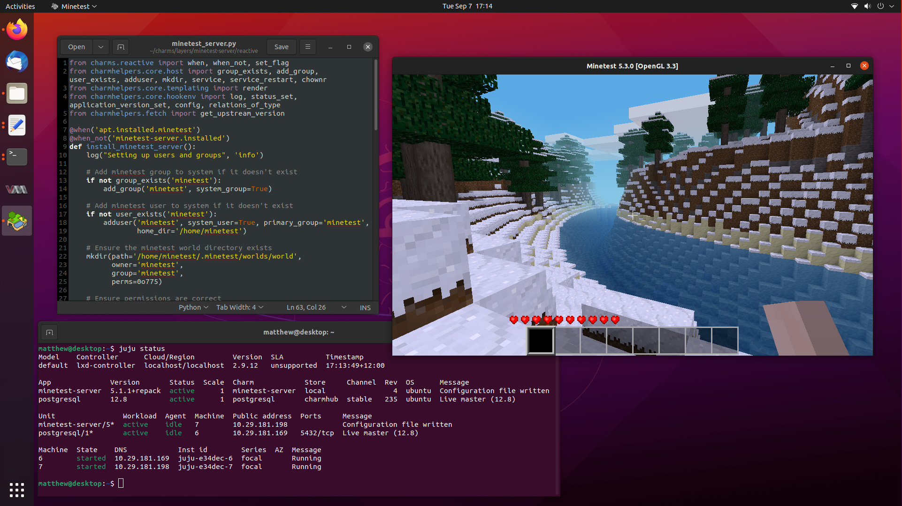

Reactive Charms are primarily written in Python, and there are a lot of different
submodules that exist to help you develop your Charm. So buckle up, because we
are going to take our little Minetest Charm to the next level.

<!--more-->

# Original Charms vs Reactive Charms

Original Charms could be written in any language, and we decided to write our
old Minetest Charm in bash. Reactive Charms are intended to be developed using
Python 3, and to take advantage of the rich Python submodule ecosystem built
and maintained by the community, which provides simple blueprints to make great
production ready code.

Reactive Charms build on many of the same mechanisms from the older Bash Charms,
and you will find that files like `metadata.yaml` and `config.yaml` are exactly
the same, so we should be able to reuse some code from our old Charm during its
port to becoming a Reactive charm.

In that case, make sure you read my previous articles so you have a good
understanding of how hook based Charms work:
* [Getting Started With Juju to Deploy and Scale Software Effortlessly](https://ruffell.nz/programming/writeups/2019/08/26/getting-started-with-juju-to-deploy-and-scale-software.html)
* [Learning How to Write Juju Charms by Creating a Minetest Charm](https://ruffell.nz/programming/writeups/2019/12/02/learning-how-to-write-juju-charms-by-creating-a-minetest-charm.html)

There are three notable changes between hook Charms and Reactive Charms.

## Charmhelpers Library Code

There is a wealth of already implemented functions you can use to help develop
your Charm, and they are in the `charmhelpers` Python module. There is excellent
[documentation](https://charm-helpers.readthedocs.io/en/latest/index.html)
available to help you find what these functions do, and what their API is.

`charmhelpers` helps you write correct code the first time, by implementing
useful things like [if a group exists](https://charm-helpers.readthedocs.io/en/latest/api/charmhelpers.core.host.html#charmhelpers.core.host.group_exists)
or [creating new groups](https://charm-helpers.readthedocs.io/en/latest/api/charmhelpers.core.host.html#charmhelpers.core.host.add_group),
[adding users](https://charm-helpers.readthedocs.io/en/latest/api/charmhelpers.core.host.html#charmhelpers.core.host.adduser),
or [adding users to groups](https://charm-helpers.readthedocs.io/en/latest/api/charmhelpers.core.host.html#charmhelpers.core.host.add_user_to_group).

You can also do things like get a [dictionary of the Charm's config.yaml](https://charm-helpers.readthedocs.io/en/latest/api/charmhelpers.core.hookenv.html#charmhelpers.core.hookenv.Config), [write to the
juju log](https://charm-helpers.readthedocs.io/en/latest/api/charmhelpers.core.hookenv.html#charmhelpers.core.hookenv.log)
or [set juju status information](https://charm-helpers.readthedocs.io/en/latest/api/charmhelpers.core.hookenv.html#charmhelpers.core.hookenv.status_set).

Have a look around, and I'm sure you will find all sorts of useful functions to
help you write your Charm.

## Flags

Reactive Charms have the ability to store state, so you can now selectively run
functions only if they meet certain conditions, stored in flags. This is super
useful, since you might only want to generate the configuration file once the
database has been configured, so you don't want config-changed to be run before
the user relates a database, for example.

It also allows us to implement finite state machines for more complex deployments
where you don't want race conditions or to jump steps, which is particularly
useful for managing critical data in storage Charms.

Flags can be named anything you want, and we use methods like `set_flag()` and
`clear_flag()` to manage them.

Flags are actually implemented in the `charms.reactive` Python module, and are
used as decorators on your functions. There are a whole bunch of different
decorators you can use, but the common ones are `when()`, `when_not()`, 
`when_any()`, `hook()`.

A simple example is to guard against only doing something once, much like a
singleton pattern but not as advanced. We can do this by setting a flag:

```python
@when_not('myprogram.installed')
def install_myprogram():
    # Get your things installed...
    
    set_flag('myprogram.installed')
```

When your Charm is first deployed, `myprogram.installed` won't be set, so we will
run the `install_myprogram()` function, and then once we set `myprogram.installed`
we can no longer fulfil the `@when_not()` decorator, and we won't run 
`install_myprogram()` again.

Neat.

## Layers

Layers are all about incorporating the flags and hooks from other Charms, and
putting them to use in your own Charm, helping the code reuse and correctness.

Layers are effectively libraries you can import, and are mostly set and forget
with no need to write any code to make them work. You can set some options in
the layer definition file, and they will be passed to layer functions as needed.

In this guide, we will take advantage of the `basic` and `apt` layers, as well
as the `pgsql` interface for database management. I will show you how they work
slightly later on.

# Reactive Charm Writing Method

I'm again going to be following along the [Reactive Charm Documentation](https://charmsreactive.readthedocs.io/en/latest/index.html)
as well as the recommended [Reactive Charm Tutorial](https://discourse.charmhub.io/t/tutorial-charm-development-beginner-part-1/377)
found on discourse.

## What You Will Need To Get Started

We will need to have Juju installed, and also charm tools. We can get both of
these from the Snap Store.

```bash
$ sudo snap install --classic juju
$ sudo snap install --classic charm
```

## Create Charm Directory Structure

Charms are a collection of text files, which are primarily split up into Python
scripts and YAML configuration files.

Much like last time, we will make a directory for our Charms to live in, but
this time, we create two more directories, `layers` and `interfaces`.

```bash
$ mkdir -p ~/charms
$ mkdir -p ~/charms/layers
$ mkdir -p ~/charms/interfaces
```

We also need to setup some environment variables for Charm tools to use, so
add the following to your `~./bashrc`:

```bash
$ cat << EOF | tee --append ~/.bashrc
export CHARM_LAYERS_DIR="~/charms/layers"
export CHARM_INTERFACES_DIR="~/charms/interfaces"
EOF
$ source ~/.bashrc
```

We can use Charm tools to automatically generate the correct directory structure
for us, so run:

```bash
$ cd ~/charms/layers
$ charm create minetest-server
```

You should now have these files in `~/charms/layers/minetest-server`:

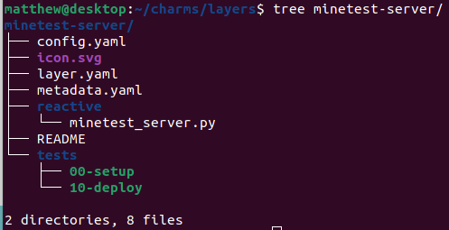

## Edit the README File

We need a README file to tell our users what our Charm is about, how to deploy
it, and how to scale it. We will tweak what we did last time, and the following
should do:

```
Minetest is a fun, free and open source voxel game inspired by Minecraft.
It supports various game modes, like survival and creative, and many more can
be added with mods.

This Charm deploys a basic game server, and is backed by a PostgreSQL database
for maximum performance. There are no mods, so you will need to add them
yourself.

To deploy:

$ juju bootstrap
$ juju deploy postgresql
$ juju deploy minetest-server
$ juju relate postgresql:db minetest-server:db
$ juju expose minetest-server
```

## Edit the metadata.yaml File

The role of `metadata.yaml` has not changed, and it still tells Juju what the
Charm is called, what it does, who wrote it, what Ubuntu distribution it is
compatible with, and what interfaces are exposed and required to function.

```yaml
name: minetest-server
summary: Minetest is a opensource voxel game designed to be modded.
maintainer: Matthew Ruffell <matthew.ruffell@canonical.com>
description: |
    Minetest is a fun, opensource voxel game engine that can be customised with
    different game modes and mods.
    This charm installs Minetest with a PostgreSQL backend.
tags:
- social
series:
- hirsute
- focal
provides:
  server:
    interface: minetest
requires:
  db:
    interface: pgsql
```

## Describe Configuration Options in config.yaml

Since we want users of our Charm to be able to configure the Minetest server
to suit their needs, such as changing the server message of the day, or the port
it is being served on, we need to define configuration variables in `config.yaml`.

This is also pretty straightforward.

The only thing to note is you should carefully consider what options you want to
expose to your users. Users don't really care about the fine details, so only
expose what most people will understand and use.

Saying that, make sure you set sensible defaults. All Charms should work out of
the box on first deployment. If people are interested in changing config, they
will, otherwise they will leave everything alone.

An example config is: (inspired by the existing config.yaml in [James Tait's
older minetest charm](https://api.jujucharms.com/charmstore/v5/~jamestait/precise/minetest-server-2/archive/config.yaml))

```yaml
options:
    port:
        default: 30000
        description: Server port to listen on
        type: int
    server-name:
        default: "Minetest server"
        description: Name of the server
        type: string
    server-description:
        default: "Juju deployed Minetest server"
        description: Description of server
        type: string
    motd:
        default: "Welcome!"
        description: Message of the day
        type: string
    strict-protocol-version-checking:
        default: "false"
        description: Set to true to disallow old clients from connecting
        type: string
    creative-mode:
        default: "false"
        description: Set to true to enable creative mode (unlimited inventory)
        type: string
    enable-damage:
        default: "false"
        description: Enable players getting damage and dying
        type: string
    default-password:
        default: ""
        description: New users need to input this password
        type: string
    default-privs:
        default: "build,shout"
        description: |
            Available privileges: build, shout, teleport, settime, privs, ban
            See /privs in game for a full list on your server and mod configuration
        type: string
    enable-pvp:
        default: "true"
        description: Whether to enable players killing each other
        type: string
```

## Set the Copyright of the Charm

All Charms should include a copyright file, which includes details about the
copyright and licensing status of the files inside the Charm.

We will again use the [debian/copyright
file format](https://www.debian.org/doc/packaging-manuals/copyright-format/1.0/)
to license our charm, by placing the following in a file called `copyright`.

We will take the [OpenStack Keystone Charm copyright](https://github.com/openstack/charm-interface-keystone/blob/master/copyright)
file as inspiration, so the below will do:

```
Format: http://www.debian.org/doc/packaging-manuals/copyright-format/1.0

Files: *
Copyright: 2021, Matthew Ruffell.
License: GPL-3

License: GPL-3
 This package is free software; you can redistribute it and/or modify
 it under the terms of the GNU General Public License as published by
 the Free Software Foundation; either version 3 of the License, or
 (at your option) any later version.
 .
 This package is distributed in the hope that it will be useful,
 but WITHOUT ANY WARRANTY; without even the implied warranty of
 MERCHANTABILITY or FITNESS FOR A PARTICULAR PURPOSE.  See the
 GNU General Public License for more details.
 .
 You should have received a copy of the GNU General Public License
 along with this package; if not, write to the Free Software
 Foundation, Inc., 51 Franklin St, Fifth Floor, Boston, MA  02110-1301 USA
 .
 On Debian systems, the complete text of the GNU General
 Public License can be found in `/usr/share/common-licenses/GPL-3'.
```

## Make an Icon for the Charm Store

If you want your Charm to look nice on the Charm store listing or on the Juju
GUI, then you should probably set an icon.

Open up `icon.svg` in Inkscape or whatever vector editor you like,
and make a nice icon:

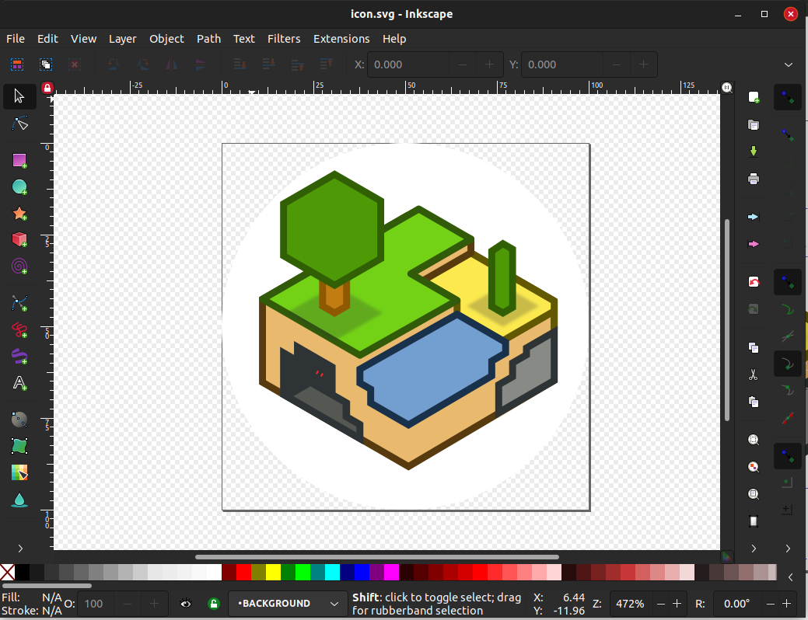

I used the icon found at `/usr/share/icons/hicolor/scalable/apps/minetest.svg`
to make this icon.

## Defining Layers and Their Options

Layers are a mechanism to integrate related Charms into your own Charm. Think
of them as libraries you can import and leverage to perform tasks correctly, so
you don't have to get into the specifics yourself.

For example, take the `layer:apt` layer. This implements package management via
apt, and it will automatically be called when the Charm is deployed in the
install phase. We can include some options in the `options:` section, and we can
tell it to automatically install minetest, without having to specify anything
more. The days of manually writing `apt install minetest` are over.

The `layer:basic` layer implements basic hooks like `start`, `stop`, and uses
magic to link different hooks and conditions to flags. This is the layer that
is also responsible for autogenerating our hooks directory when we run `charm
build`.

Finally, we also specify the `interface:pgsql` interface, which tells Juju that
we will be using the postgresql charm, and that we will be using related flags
like `db.connected` and `db.database.available`.

Our final `layers.yaml` looks like the following:

```
includes:
  - 'layer:basic'
  - 'layer:apt'
  - 'interface:pgsql'
options:
  apt:
    packages:
      - minetest
```

## Creating Templates for Game Configuration and System Service Files

Templates are a wonderful new addition to Reactive Charms. They allow us to
define our configuration files in one place, and fill out any unknown variables


```
$ mkdir templates
```

We will need two templates. One, a systemd service file to run minetest on boot,
and the other will be the actual minetest configuration.

Let's do the systemd service first.

Make a file called `minetest.service` and put the following service description in it:

```
[Unit]
Description=Minetest
Documentation=https://wiki.minetest.net/Main_Page

[Service]
Type=simple
User=minetest

ExecStart=/usr/games/minetest --server

ExecStop=/bin/kill -2 $MAINPID

[Install]
WantedBy=multi-user.target
```

Note, we can use the Jinja2 templating engine to fill variables for us when we
render the file later on. We can place values within `'{{ object.attribute }}'`
style syntax.

For example, we can fetch the `server-name` configuration from the Juju config
entries with `'{{ config["server-name" }}'`. We will pass 
in database details later, and use `my_database` as an object placeholder for now.

Let's use this information to create the minetest configuration file. Name it
`world.mt` and fill it with:

```
port =  {{ config["port"] }} 
server_name =  {{ config["server-name"] }} 
server_description =  {{ config["server_description"] }} 
motd =  {{ config["motd"] }} 
strict_protocol_version_checking =  {{ config["strict-protocol-version-checking"] }} 
creative_mode =  {{ config["creative-mode"] }} 
enable_damage =  {{ config["enable-damage"] }} 
default_password =  {{ config["default-password"] }} 
default_privs =  {{ config["default-privs"] }} 
enable_pvp =  {{ config["enable-pvp"] }} 
gameid = minetest
backend = postgresql
player_backend = postgresql
auth_backend = sqlite3
pgsql_connection = host= {{ database["private-address"] }}  port= {{ database["port"] }}  user= {{ database["user"] }}  password= {{ database["password"] }}  dbname= {{ database["database"] }} 
pgsql_player_connection = host= {{ database["private-address"] }}  port= {{ database["port"] }}  user= {{ database["user"] }}  password= {{ database["password"] }}  dbname= {{ database["database"] }} 
```

## Writing the Actual Deployment and Management Code

In Reactive Charms, we implement the logic to manage the Charm in 
`reactive/charm_name.py`, or in our case, `reactive/minetest_server.py`.

Have a read of the final code, and I'll commentate how it works below.

```python
from charms.reactive import when, when_not, set_flag
from charmhelpers.core.host import group_exists, add_group, user_exists, adduser, mkdir, service, service_restart, chownr
from charmhelpers.core.templating import render
from charmhelpers.core.hookenv import log, status_set, application_version_set, config, relations_of_type
from charmhelpers.fetch import get_upstream_version

@when('apt.installed.minetest')
@when_not('minetest-server.installed')
def install_minetest_server():
    log("Setting up users and groups", 'info')
    
    # Add minetest group to system if it doesn't exist
    if not group_exists('minetest'):
        add_group('minetest', system_group=True)
    
    # Add minetest user to system if it doesn't exist
    if not user_exists('minetest'):
        adduser('minetest', system_user=True, primary_group='minetest',
                home_dir='/home/minetest')
    
    # Ensure the minetest world directory exists
    mkdir(path='/home/minetest/.minetest/worlds/world',
          owner='minetest',
          group='minetest',
          perms=0o775)
    
    # Ensure permissions are correct
    chownr(path='/home/minetest',
           owner='minetest',
           group='minetest',
           chowntopdir=True)
    
    log("Installing systemd service files", 'info')
    
    # Install the systemd service file
    render(source='minetest.service',
           target='/etc/systemd/system/minetest.service',
           owner='root',
           group='root',
           perms=0o644,
           context={
           })
    
    # Set the version number in Juju to what was installed
    application_version_set(get_upstream_version('minetest'))
    
    # Enable the minetest service
    service('enable', 'minetest.service')
    
    # We are all installed now, we don't need to call this function again
    set_flag('minetest-server.installed')
    
    
@when('config.changed')
@when('minetest.database.configured')
def minetest_regenerate_configuration():
    status_set('maintenance', 'Configuring minetest')
    
    # Fetch our minetest and database configuration variables
    my_config = config()
    my_database = relations_of_type('db')[0]
    
    log("Installing minetest configuration file", 'info')
    
    # Populate the configuration file and install it in place
    render(source='world.mt',
           target='/home/minetest/.minetest/worlds/world/world.mt',
           owner='minetest',
           group='minetest',
           perms=0o664,
           context={
               'config':my_config,
               'database':my_database,
           })
    
    # Restart the minetest service to take on new config
    service_restart('minetest.service')
    
    # Tell Juju that minetest is good to go
    status_set('active', 'Configuration file written')

@when('db.database.available')
def database_connected():
    # We have a database now, so we can generate config anytime now
    set_flag('minetest.database.confgured')
    
    # Generate the config file with database credentials
    minetest_regenerate_configuration()

@when_not('db.connected')
def missing_database():
    status_set('blocked', 'Relation to postgresql required')
```

We first import all the functions we need from the `charmhelpers` python module,
which is actually quite a lot for our small piece of code, but it's okay, since
we want charmhelpers to do our heavy lifting.

We next have a function `install_minetest_server()`, that acts as a singleton
like I described when I mentioned how flags work. It has an extra condition
though, and that is `@when('apt.installed.minetest')`. This ensures that
we only call `install_minetest_server()` once the `apt` layer has completed
installing the `minetest` package. 

In `install_minetest_server()`, we set up the `minetest` user and group, set up
a `/home` directory and world directory, and install a systemd service file. We
also get the minetest package version and expose it to Juju for pretty 
`juju status` prompts with our actual minetest version.

Next up we have `minetest_regenerate_configuration()` which collects the
Charms config parameters, and database relation parameters, and renders the
variables into the template config file we created above. Smart right? I thought
so. We also restart the systemd service to load the new configuration, and set
the Charm's status to `active`.

We used two flags for `minetest_regenerate_configuration()`, which makes sure we
only call the function when both `config.changed` and `minetest.database.confgured`
is set. `config.changed` acts like a hook in reality, and `minetest.database.confgured`
is what actually stops the function from being run before a database is available.

To pull this off, we have two functions, `missing_database()` and 
`database_connected()`. `missing_database()` sets the Charms status to `blocked`
when there isn't a postgresql relation present, which is what we want, since
without a backing database, we can't play minetest.

`database_connected()` is called when we have a postgresql relation, and the
database is created and we have user credientals available. This is from the 
`db.database.available` flag that the postgresql interface sets. We take the
opportunity to set 'minetest.database.confgured' so we can go ahead and render
our configuration, and then manually call `minetest_regenerate_configuration()`
to make that happen.

Its not too complicated, and it actually turned out to be less code than the old
hook based Charm.

# Deploying the Charm

Now that everything is in place, let's go ahead and deploy the Charm to our
machines, and get our minetest server running.

## Creating the Controller

We will be using LXD as the cloud backend for our Juju model today, so go ahead
and deploy a juju controller with the "localhost" backend:

```bash
$ juju bootstrap --bootstrap-series=hirsute localhost lxd-controller
Creating Juju controller "lxd-controller" on localhost/localhost
Looking for packaged Juju agent version 2.9.12 for amd64
Located Juju agent version 2.9.12-ubuntu-amd64 at https://streams.canonical.com/juju/tools/agent/2.9.12/juju-2.9.12-ubuntu-amd64.tgz
To configure your system to better support LXD containers, please see: https://github.com/lxc/lxd/blob/master/doc/production-setup.md
Launching controller instance(s) on localhost/localhost...
 - juju-6b05e2-0 (arch=amd64)                 
Installing Juju agent on bootstrap instance
Fetching Juju Dashboard 0.8.1
Waiting for address
Attempting to connect to 10.29.181.61:22
Connected to 10.29.181.61
Running machine configuration script...
Host key fingerprint is SHA256:H0KFu2A5tmmM2blQ5dJ70iMhav+6RJ+4wKrkTp08y2M
+---[RSA 2048]----+
|         ..      |
|        o.       |
|       =..       |
|      X.=        |
|     X.OS=.      |
|  o.B.Bo=++.     |
| o *o+o.o+..     |
|+ .Eooo.         |
|o+oo. ++.        |
+----[SHA256]-----+
Bootstrap agent now started
Contacting Juju controller at 10.29.181.61 to verify accessibility...

Bootstrap complete, controller "lxd-controller" is now available
Controller machines are in the "controller" model
Initial model "default" added
```

Note, I used `--bootstrap-series=hirsute` to use Hirsute as the operating system
for the controller.

We can confirm our controller deployed properly with `juju controllers`:

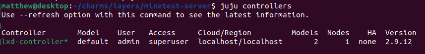

Looking at `juju status` we now have a nice empty model:

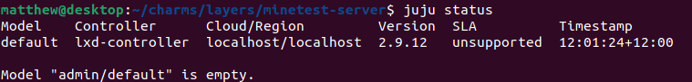

## Deploying the PostgreSQL Charm

Our Minetest Charm depends on postgresql as a database backend to store our
player information and world data, so let's go ahead and deploy it first.

Things have changed slightly from the last time I wrote a blog post, with
Charms now being able to be found on [Charmhub](https://charmhub.io/), instead
of the Charm Store.

So, we go to Charmhub, and search for postgresql, and come across the entry
[postgresql at revision 235](https://charmhub.io/postgresql).

Deploying it is simple, we just run:

```bash
$ juju deploy postgresql
Located charm "postgresql" in charm-hub, revision 235
Deploying "postgresql" from charm-hub charm "postgresql", revision 235 in channel stable
```

and we can watch `juju status` while we wait.

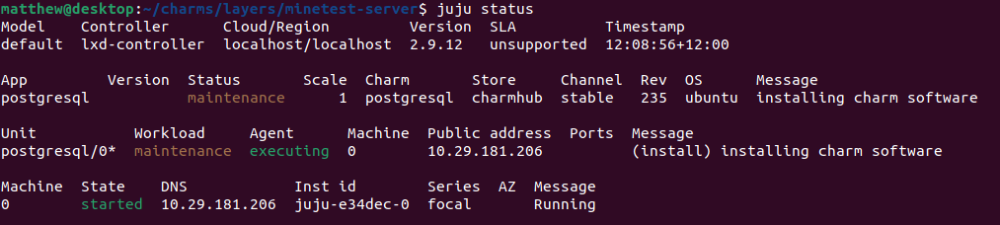

Eventually it will complete, and postgresql will be ready to use:

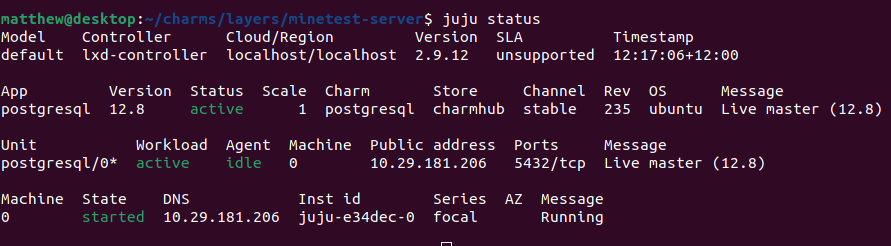

## Proofing and Building our Minetest Charm

We can do a quick sanity check over our charm with `charm proof`, which tells us
if we are missing anything critical, or need to change some boilerplate code.

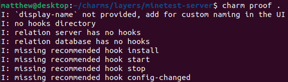

In our case, we are missing some hooks, which we will add later.

If everything looks okay, go ahead and build your charm with `charm build`:

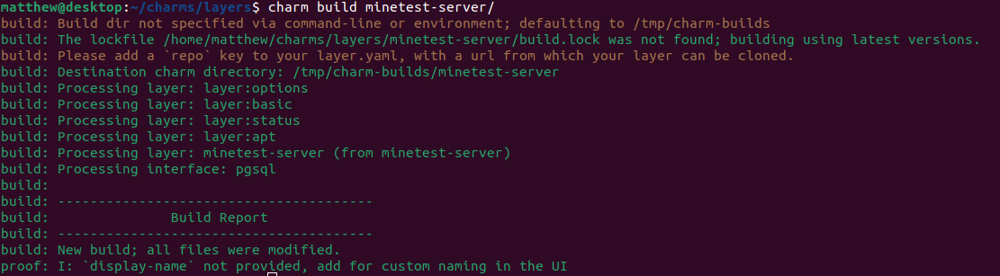

All green, fantastic! Time to deploy.

## Deploying our Minetest Charm

Our Charm was built and placed into `/tmp/charm-builds/minetest-server`, so
point Juju at that location, and deploy away:

```bash
$ juju deploy /tmp/charm-builds/minetest-server
Located local charm "minetest-server", revision 0
Deploying "minetest-server" from local charm "minetest-server", revision 0
```

We can watch `juju status` like normal to see how it went:

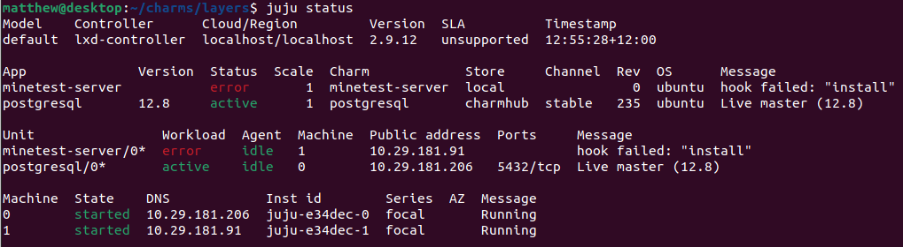

Ouch. Error in the install hook. Not a problem, Juju can tell us what went
wrong in an instant, with the `juju debug-log` command. Run that, and let's see
what went wrong:

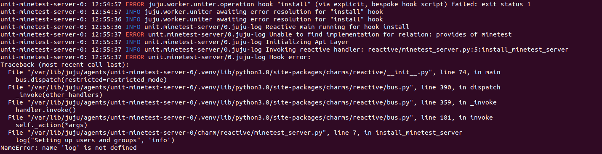

Silly me, seems I forgot to include a logger module, not to worry, we can
fix that right up. Add the following to minetest-server.py at the top:

```python
from charmhelpers.core.hookenv import log, status_set
```

and we should be good to go. But if you happen to have a different problem,
don't forget you can `juju ssh minetest-server/0` to get a shell inside the
minetest LXD container, where you can debug from there.

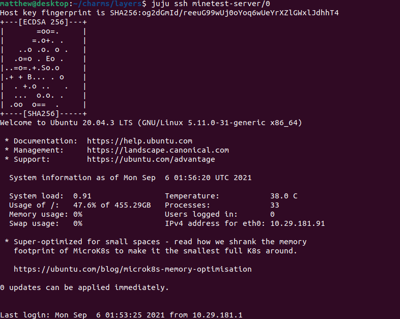

The charm itself lives in `/var/lib/juju/agents/unit-minetest-server-0/charm/`,
so `cd` into there, edit `minetest-server.py` in `vim`, save and exit.

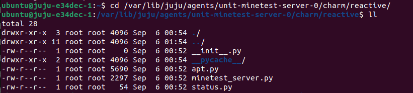

We don't have to redeploy the entire Charm to get small bugfixes, and production
servers you might not have that luxury at all. Instead, we can run:

```bash
$ juju resolved minetest-server/0
```

and this tells Juju that we fixed the errors, and to re-try that hook again. If
we check `juju status`, it seems to have worked:

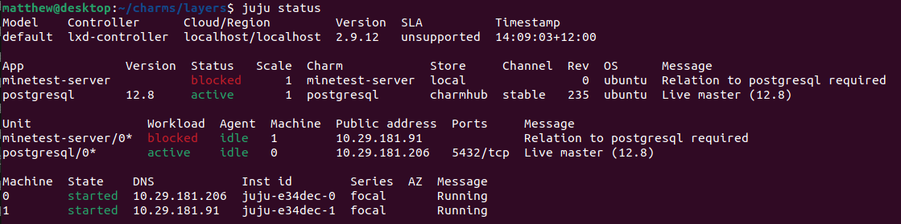

We are now waiting on our database connection, so let's make the relation happen:

```bash
$ juju relate postgresql:db minetest-server:db
```

Checking `juju status` now, we see all green, and that our configuration file
has been written correctly:

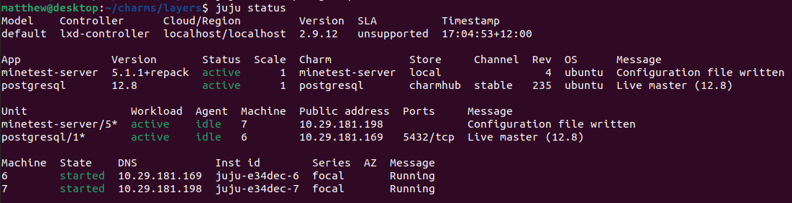

This is promising! Let's expose the port:

```bash
$ juju expose minetest-server
```

Open up minetest, and connect to the server listed at `private-address` in
`juju status`, which is `10.29.181.198` in my case, on port `30000`, which we
set in our configuration:

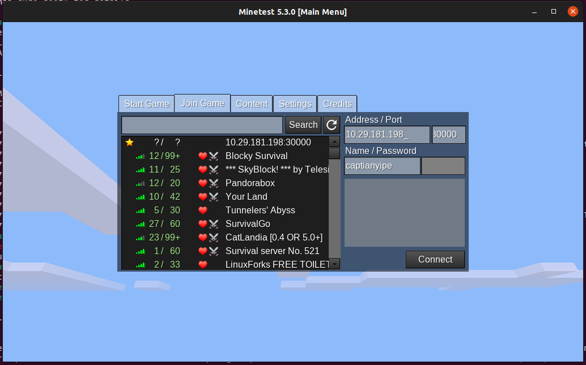

And click connect, and wow it works! We find ourselves in a snowy world, all
powered by Minetest + Postgresql + Juju with Reactive Charms. Very fancy, and
production ready.

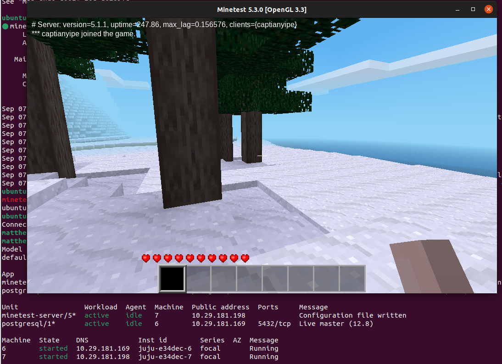

# Debugging the Charm

Now that we have written our Reactive Charm, we also need to be able to debug it
and know what to do when things go wrong. These tips should help.

## Getting Debug Logs

As mentioned when we were writing the Reactive code, your first port of call
when you run into a problem is to run `juju debug-log`. This gives you the log
outputs of all active running Charms, and any error messages like stack traces
are very prominent and repeated often, so you won't miss anything.

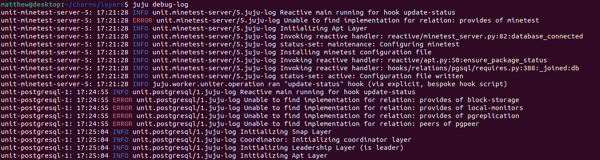

Make sure to make use of `log()` from `charmhelpers.core.hookenv`, and use it
to write useful information to the Juju log, as well to print debug information
like a `print` statement or `printk`. I did this a lot when writing this charm,
so I could see the contents of `relations_of_type()` with Python's `dir()`.

It's also very helpful to have `juju debug-log` running in a window on a second
screen so you can keep a detailed watch of deployment progress when you are
developing your charm.

## Debugging Hooks and Examining Flags at Runtime

In the previous article, we used `juju debug-hooks application-name/unit` to
access a `tmux` session to see what data is exchanged during various hooks like
`db-relation-joined` and `config-changed`.

We can still do all of that, but `juju debug-hooks` has gotten more powerful
for Reactive Charms.

If you run:

```bash
$ juju debug-hooks minetest-server/5
```

You get the same `tmux` session:

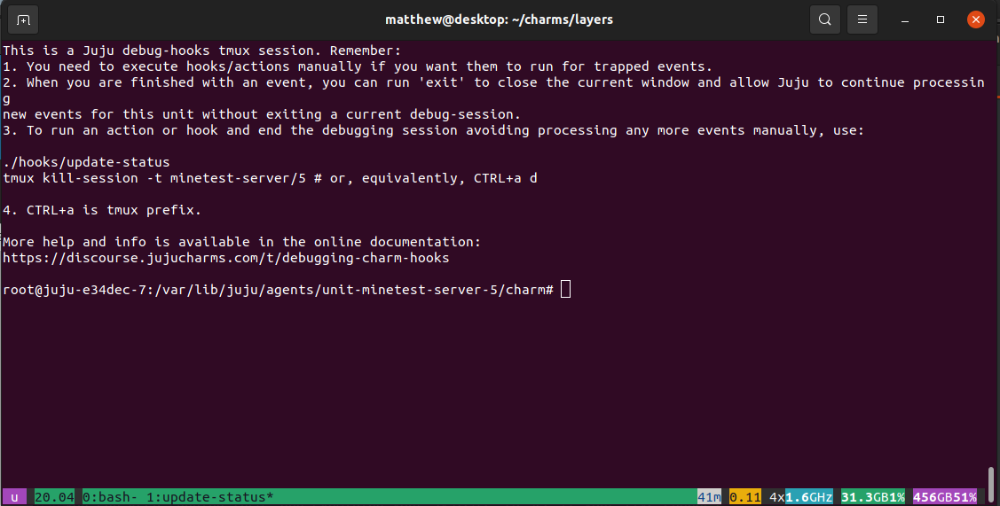

Now, we can run hooks manually by executing the python scripts that are
backing them, in the `hooks` directory of the Charm.

The session is opened to the Charm directory, at 
`var/lib/juju/agents/unit-minetest-server-5/charm`, so we can `ls hooks/`
to see what we can run:

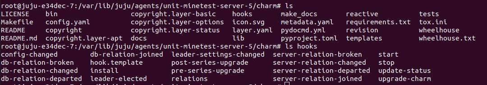

If we wanted to run `config-changed` manually, we can do this with:

```bash
$ python3 hooks/config-changed
```

and it runs. Very useful if you need to watch what is happening in 
`juju debug-log` concurrently.

But what happens if your flags aren't getting hit? No worries, we can see what
the values for the flags are by running:

```bash
$ charms.reactive -p get_flags
```

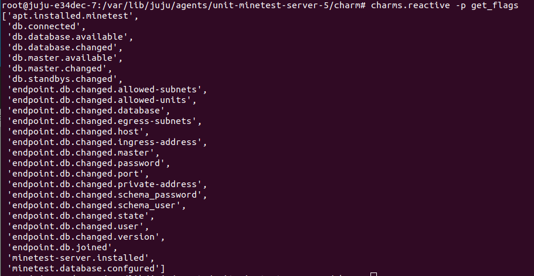

Not only can we see what they are actually called (which is useful in itself,
I thought `db.available` was a flag, but it was actually called 
`db.database.available` instead, and `get_flags()` told me this), but we can
also see if they are set or unset, with commands like `all_flags_set()`,
`get_unset_flags()`, `is_flag_set()`, and we can also change flags with
`set_flag()`, `clear_flag()`, `toggle_flag()`. Very useful.

# Cleaning Up

Once we have had our fun and want to reclaim some disk space back, we can tear
down and remove the deployment with:

```bash
$ juju remove-application minetest-server
removing application minetest-server
$ juju remove-application postgresql
removing application postgresql
```

You can check `juju status` to keep an eye on progress. If anything gets stuck
you can forcefully remove the machine number 5 with:

```bash
$ juju remove-machine 5 --force
```

If you want to remove your controller, then run:

```bash
$ juju destroy-controller lxd-controller --destroy-all-models
WARNING! This command will destroy the "lxd-controller" controller.
This includes all machines, applications, data and other resources.

Continue? (y/N):y
Destroying controller
Waiting for hosted model resources to be reclaimed
Waiting for 1 model
All hosted models reclaimed, cleaning up controller machines
```

# Conclusion

In this article we revisited writing Juju Charms, this time taking the more
modern and robust Reactive Charms for a spin. We ported our simple Minetest
Charm to Reactive, which was quite straightforward, and managed to make our
code simpler than when had hook based Charms.

I enjoyed digging into all the new Charmhelper functionality and getting my
head around how flags work, and I hope it has been useful with helping you to
write your own Reactive Charms.

Hopefully you enjoyed the read, and as always feel free to [contact me](/about).

Matthew Ruffell
