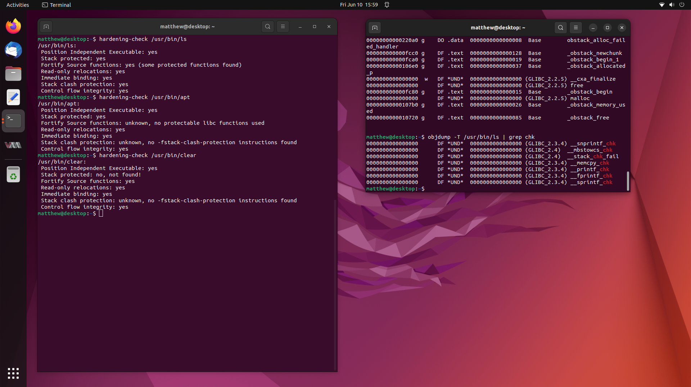

Not too long ago, I worked on a fairly interesting case where a user claimed
that many of the binaries on their system were missing Stack Canaries provided
through `-fstack-protector-strong` and additionally, many were missing
Fortify Source being enabled through `-D_FORTIFY_SOURCE=2`.

This is most unusual, since these compiler flags, along with many others, are
enabled by default for all packages in the Ubuntu archive.



So in this writeup, we are going to investigate this user's claims, and try get
to the bottom of the mystery of the missing compiler hardening options in
binaries from the Ubuntu archive. Stay tuned.

<!--more-->

# What Even are Stack Canaries and Fortify Source?

We are referring to a set of compiler flags that GCC and LLVM support in regard
to applying security hardening features to binaries at compile time, so that
they might be able to detect mischief at runtime. These flags are designed to
be implemented in any program, and the programmer doesn't need to know they are
there for them to work.

## Stack Canaries

Stack Canaries provide a basic check to see if a buffer overflow has occurred
before we return from a function call, by popping the return address off the
stack and using it as the next instruction pointer to be executed.

If we add a "canary" at compile time, which is just a random number placed at
the end of the stack, when we go to return from the function, we test the number
on the stack versus what we expect it to be, and if it matches, it is likely no
buffer overflow has occurred, and we return. If it fails, we call a function
`__stack_chk_fail` which prints the below error, and kills the process, since
it is very likely something has overflowed the stack frame and it could be an
attacker trying to redirect the flow of execution to elsewhere in the program.

The error:
```
*** stack smashing detected ***
Aborted
```

## Fortify Source

Fortify Source builds on the idea of Stack Canaries, by adding a few more checks
to various functions to see if a buffer overflow has occurred. It instruments
functions like `memcpy`, `strcat` and `strncpy` and adds things like extra
length checks, checks flags for various buffers that have been allocated, that
sort of thing.

The compiler transparently replaces calls to normal `memcpy` etc with those of
the form `__memcpy_chk`.

# The Problem

The user opened a case, and provided a big list of binaries that seem to be
missing Stack Canaries, and Fortify Source protections, and didn't offer much
more information. I already suspect that the user is running some sort of
automated testing tool over their system, and this was just the output.

For example, lets look at a freshly debootstrapped Jammy system:

```
Binaries missing Stack Canaries:
/usr/bin/clear
/usr/bin/dbus-uuidgen
/usr/bin/free
/usr/bin/getconf
/usr/bin/locale-check
/usr/bin/rev
/usr/bin/tabs
/usr/bin/tempfile
/usr/bin/xxd
/usr/sbin/findfs
/usr/sbin/fstab-decode
/usr/sbin/ldconfig.real
/usr/sbin/mklost+found
/usr/sbin/nologin
/usr/sbin/pivot_root
/usr/sbin/setcap
/usr/sbin/vcstime

Binaries missing Fortify Source:
/usr/bin/apt
/usr/bin/apt-cdrom
/usr/bin/apt-config
/usr/bin/apt-extracttemplates
/usr/bin/apt-get
/usr/bin/apt-mark
/usr/bin/apt-sortpkgs
/usr/bin/getconf
/usr/bin/getent
/usr/bin/iconv
/usr/bin/ischroot
/usr/bin/locale
/usr/bin/localedef
/usr/bin/pldd
/usr/bin/update-mime-database
/usr/bin/zdump
/usr/sbin/dmsetup
/usr/sbin/dmstats
/usr/sbin/iconvconfig
/usr/sbin/ldconfig.real
/usr/sbin/zic
```

The actual output was quite a bit longer, and more like the following list,
taken from a fresh Jammy Server VM with `devscripts` installed:

[Example output from a system with more packages.](/assets/bin/devscripts_missing_canaries_fortify_sources.txt)

I was quite surprised at the amount of binaries which claim to have no Stack
Canaries present, and are also missing Fortify Sources protections. I thought
that this has to be a mistake, since these protections are enabled for all
packages by default.

# Compiler Flags Set in Ubuntu by Default

If you are ever wondering what compiler flags your binaries are built with by
default in the Ubuntu archive, have a read of the [CompilerFlags](https://wiki.ubuntu.com/ToolChain/CompilerFlags)
wiki page.

## Stack Canaries

Reading the wiki page, `-fstack-protector` has been enabled for all packages
by default since Ubuntu 6.10, and was extended to include greater coverage in
more binaries being built with the stack protector with
`--param ssp-buffer-size=4` by default in 10.10.

Currently `-fstack-protector-strong` is the default compiler flag, and this has
been enabled for all packages since 14.10.

## Fortify Source

The wiki mentions `-D_FORTIFY_SOURCE=2` has been enabled for all packages since
8.10, which is a really long time. It does only apply to packages built with
`-O1` optimisation or higher, but I would expect the amount of packages not
using `-O2` or higher to be very low.

So why do we have so many binaries which claim to be missing these protections?

# Manual Checking

A good quick way to check a binary is to examine the build log, and see if it
includes the compiler flags when the object file is being built.

## Stack Canaries

Lets take the first item off the list for missing Stack Canaries, `/usr/bin/clear`.

`/usr/bin/clear` is part of the `ncurses-bin` package:

```
$ apt-file search /usr/bin/clear
ncurses-bin: /usr/bin/clear
```

We can look this package up on Launchpad, [ncurses 6.3-2](https://launchpad.net/ubuntu/+source/ncurses/6.3-2)
and from there find the [build for Jammy](https://launchpad.net/ubuntu/+source/ncurses/6.3-2/+build/23070422)
and then we can examine the [buildlog for Jammy](https://launchpadlibrarian.net/580830290/buildlog_ubuntu-jammy-amd64.ncurses_6.3-2_BUILDING.txt.gz)

Eventually, we find where it is compiled:

```
gcc -DHAVE_CONFIG_H -I../progs -I. -I../../progs -I../include -I../../progs/../include
 -Wdate-time -D_FORTIFY_SOURCE=2 -D_DEFAULT_SOURCE -D_XOPEN_SOURCE=600 -DNDEBUG 
 -g -O2 -ffile-prefix-map=/<<PKGBUILDDIR>>=. -flto=auto -ffat-lto-objects -flto=auto
 -ffat-lto-objects -fstack-protector-strong -Wformat --param max-inline-insns-single=1200 
 -Werror=format-security -fPIC -c ../../progs/clear.c -o ../obj_s/clear.o
```

It very clearly has `-fstack-protector-strong` enabled. This is a false positive.

## Fortify Source

Again, lets take the first item off the list for missing Fortify Source, 
`/usr/bin/apt`. This is obviously part of the `apt` package, so let's find
[apt on launchpad](https://launchpad.net/ubuntu/+source/apt/2.4.5), and next
the [build for Jammy](https://launchpad.net/ubuntu/+source/apt/2.4.5/+build/23537350)
and then the [buildlog for Jammy](https://launchpadlibrarian.net/596069244/buildlog_ubuntu-jammy-amd64.apt_2.4.5_BUILDING.txt.gz).

After looking for a long time, we come across:

```
[103/1085] : && /usr/bin/c++ -g -O2 -ffile-prefix-map=/<<PKGBUILDDIR>>=. -flto=auto
 -ffat-lto-objects -flto=auto -ffat-lto-objects -fstack-protector-strong -Wformat
 -Werror=format-security -Wdate-time -D_FORTIFY_SOURCE=2 -Wl,-Bsymbolic-functions 
 -flto=auto -ffat-lto-objects -flto=auto -Wl,-z,relro -Wl,-z,now -Wl,--as-needed 
 cmdline/CMakeFiles/apt.dir/apt.cc.o -o cmdline/apt  -Wl,
 -rpath,/<<PKGBUILDDIR>>/obj-x86_64-linux-gnu/apt-private:/<<PKGBUILDDIR>>/obj-x86_64-linux-gnu/apt-pkg:  
 apt-private/libapt-private.so.0.0.0  apt-pkg/libapt-pkg.so.6.0.0 && :
```

This also very clearly has `-D_FORTIFY_SOURCE=2` enabled. Another false positive.

# Automated Scanning Tools

So, now we are beginning to suspect that whatever automated scanning tool was
being used is missing information and is not able to determine if these compiler
flags have been enabled or not.

Now we just need to find a tool and see how it works, so we can investigate its
shortcomings.

I came across the upstream [debian hardening webpage](https://wiki.debian.org/Hardening), 
and found the validation section particularly interesting.

It suggested running "hardening-check" from the devscripts package, so I tried
that for a known good binary, such as /usr/bin/ls:

```
$ hardening-check /usr/bin/ls
/usr/bin/ls:
 Position Independent Executable: yes
 Stack protected: yes
 Fortify Source functions: yes (some protected functions found)
 Read-only relocations: yes
 Immediate binding: yes
 Stack clash protection: yes
 Control flow integrity: yes
```

Okay, hardening-check can tell if the stack canary is present, and if fortify
source hardened functions are present. 

I wrote up a quick script that calls `hardening-check`, and prints the binaries
"missing" Stack Canaries and Fortify Source to the output. This script is how
I created the two outputs in "The Problem" section.

```sh
BINARIES="/usr/bin/* /usr/sbin/*"
echo "Binaries missing Stack Canaries:"
for f in $BINARIES
do
	hardening-check $f 2> /dev/null | grep "Stack protected" | grep -q "no" && echo $f
done
echo

echo "Binaries missing Fortify Source:"
for f in $BINARIES
do
	hardening-check $f 2> /dev/null | grep "Fortify Source" | grep -q "no" && echo $f
done
echo
```

Okay, now we have an automated scanning tool of our own, lets dig into how it
works.

# Investigation

I imagine what `hardening-check` is doing is dumping the dynamic symbol table 
from the ELF header, and comparing those functions to hardened ones.

e.g.

```
$ objdump -T /usr/bin/ls
/usr/bin/ls:     file format elf64-x86-64

DYNAMIC SYMBOL TABLE:
00000      DF *UND*	00000 (GLIBC_2.3)  __ctype_toupper_loc
00000      DF *UND*	00000 (GLIBC_2.2.5) getenv
00000      DO *UND*	00000 (GLIBC_2.2.5) __progname
00000      DF *UND*	00000 (GLIBC_2.2.5) sigprocmask
00000      DF *UND*	00000 (GLIBC_2.3.4) __snprintf_chk
00000      DF *UND*	00000 (GLIBC_2.2.5) raise
00000      DF *UND*	00000 (GLIBC_2.34) __libc_start_main
00000      DF *UND*	00000 (GLIBC_2.2.5) abort
00000      DF *UND*	00000 (GLIBC_2.2.5) __errno_location
00000      DF *UND*	00000 (GLIBC_2.2.5) strncmp
00000  w   D  *UND*	00000  Base        _ITM_deregisterTMCloneTable
00000      DO *UND*	00000 (GLIBC_2.2.5) stdout
00000      DF *UND*	00000 (GLIBC_2.2.5) localtime_r
00000      DF *UND*	00000 (GLIBC_2.2.5) _exit
00000      DF *UND*	00000 (GLIBC_2.2.5) strcpy
00000      DF *UND*	00000 (GLIBC_2.4)  __mbstowcs_chk
00000      DF *UND*	00000 (GLIBC_2.2.5) __fpending
00000      DF *UND*	00000 (GLIBC_2.2.5) isatty
00000      DF *UND*	00000 (GLIBC_2.2.5) sigaction
00000      DF *UND*	00000 (GLIBC_2.2.5) iswcntrl
00000      DF *UND*	00000 (GLIBC_2.2.5) wcswidth
00000      DF *UND*	00000 (GLIBC_2.2.5) localeconv
00000      DF *UND*	00000 (GLIBC_2.2.5) mbstowcs
00000      DF *UND*	00000 (GLIBC_2.2.5) readlink
00000      DF *UND*	00000 (GLIBC_2.17) clock_gettime
00000      DF *UND*	00000 (GLIBC_2.2.5) setenv
00000      DF *UND*	00000 (GLIBC_2.2.5) textdomain
00000      DF *UND*	00000 (GLIBC_2.2.5) fclose
00000      DO *UND*	00000 (GLIBC_2.2.5) optind
00000      DF *UND*	00000 (GLIBC_2.2.5) opendir
00000      DF *UND*	00000 (GLIBC_2.2.5) getpwuid
00000      DF *UND*	00000 (GLIBC_2.2.5) bindtextdomain
00000      DF *UND*	00000 (GLIBC_2.2.5) dcgettext
00000      DF *UND*	00000 (GLIBC_2.2.5) __ctype_get_mb_cur_max
00000      DF *UND*	00000 (GLIBC_2.2.5) strlen
00000      DF *UND*	00000 (GLIBC_2.4)  __stack_chk_fail
00000      DF *UND*	00000 (GLIBC_2.2.5) getopt_long
00000      DF *UND*	00000 (GLIBC_2.2.5) mbrtowc
00000      DF *UND*	00000 (LIBSELINUX_1.0) freecon
00000      DF *UND*	00000 (GLIBC_2.2.5) strchr
00000      DF *UND*	00000 (GLIBC_2.2.5) getgrgid
00000      DF *UND*	00000 (GLIBC_2.2.5) snprintf
00000      DF *UND*	00000 (GLIBC_2.2.5) __overflow
00000      DF *UND*	00000 (GLIBC_2.2.5) strrchr
00000      DF *UND*	00000 (GLIBC_2.2.5) gmtime_r
00000      DF *UND*	00000 (GLIBC_2.2.5) lseek
00000      DF *UND*	00000 (GLIBC_2.2.5) __assert_fail
00000      DF *UND*	00000 (GLIBC_2.2.5) fnmatch
00000      DF *UND*	00000 (GLIBC_2.2.5) memset
00000      DF *UND*	00000 (GLIBC_2.2.5) ioctl
00000      DF *UND*	00000 (GLIBC_2.2.5) getcwd
00000      DF *UND*	00000 (GLIBC_2.2.5) closedir
00000      DF *UND*	00000 (GLIBC_2.33) lstat
00000      DF *UND*	00000 (GLIBC_2.2.5) memcmp
00000      DF *UND*	00000 (GLIBC_2.2.5) _setjmp
00000      DF *UND*	00000 (GLIBC_2.2.5) fputs_unlocked
00000      DF *UND*	00000 (GLIBC_2.2.5) calloc
00000      DF *UND*	00000 (GLIBC_2.2.5) strcmp
00000      DF *UND*	00000 (GLIBC_2.2.5) signal
00000      DF *UND*	00000 (GLIBC_2.2.5) dirfd
00000      DF *UND*	00000 (GLIBC_2.2.5) fputc_unlocked
00000      DO *UND*	00000 (GLIBC_2.2.5) optarg
00000      DF *UND*	00000 (GLIBC_2.3.4) __memcpy_chk
00000      DF *UND*	00000 (GLIBC_2.2.5) sigemptyset
00000  w   D  *UND*	00000  Base        __gmon_start__
00000      DF *UND*	00000 (GLIBC_2.14) memcpy
00000      DO *UND*	00000 (GLIBC_2.2.5) program_invocation_name
00000      DF *UND*	00000 (GLIBC_2.2.5) tzset
00000      DF *UND*	00000 (GLIBC_2.2.5) fileno
00000      DF *UND*	00000 (GLIBC_2.2.5) tcgetpgrp
00000      DF *UND*	00000 (GLIBC_2.2.5) readdir
00000      DF *UND*	00000 (GLIBC_2.2.5) wcwidth
00000      DF *UND*	00000 (GLIBC_2.2.5) fflush
00000      DF *UND*	00000 (GLIBC_2.2.5) nl_langinfo
00000      DF *UND*	00000 (GLIBC_2.2.5) strcoll
00000      DF *UND*	00000 (GLIBC_2.2.5) mktime
00000      DF *UND*	00000 (GLIBC_2.2.5) __freading
00000      DF *UND*	00000 (GLIBC_2.2.5) fwrite_unlocked
00000      DF *UND*	00000 (GLIBC_2.2.5) realloc
00000      DF *UND*	00000 (GLIBC_2.2.5) stpncpy
00000      DF *UND*	00000 (GLIBC_2.2.5) setlocale
00000      DF *UND*	00000 (GLIBC_2.3.4) __printf_chk
00000      DF *UND*	00000 (GLIBC_2.28) statx
00000      DF *UND*	00000 (GLIBC_2.2.5) timegm
00000      DF *UND*	00000 (GLIBC_2.2.5) strftime
00000      DF *UND*	00000 (GLIBC_2.2.5) mempcpy
00000      DF *UND*	00000 (GLIBC_2.2.5) memmove
00000      DF *UND*	00000 (GLIBC_2.2.5) error
00000      DO *UND*	00000 (GLIBC_2.2.5) __progname_full
00000      DF *UND*	00000 (GLIBC_2.2.5) fseeko
00000      DF *UND*	00000 (GLIBC_2.2.5) strtoumax
00000      DF *UND*	00000 (GLIBC_2.2.5) unsetenv
00000      DF *UND*	00000 (GLIBC_2.2.5) __cxa_atexit
00000      DF *UND*	00000 (GLIBC_2.2.5) wcstombs
00000      DF *UND*	00000 (GLIBC_2.3)  getxattr
00000      DF *UND*	00000 (GLIBC_2.2.5) gethostname
00000      DF *UND*	00000 (GLIBC_2.2.5) sigismember
00000      DF *UND*	00000 (GLIBC_2.2.5) exit
00000      DF *UND*	00000 (GLIBC_2.2.5) fwrite
00000      DF *UND*	00000 (GLIBC_2.3.4) __fprintf_chk
00000  w   D  *UND*	00000  Base        _ITM_registerTMCloneTable
00000      DF *UND*	00000 (LIBSELINUX_1.0) getfilecon
00000      DF *UND*	00000 (GLIBC_2.2.5) fflush_unlocked
00000      DF *UND*	00000 (GLIBC_2.2.5) mbsinit
00000      DF *UND*	00000 (LIBSELINUX_1.0) lgetfilecon
00000      DO *UND*	00000 (GLIBC_2.2.5) program_invocation_short_name
00000      DF *UND*	00000 (GLIBC_2.2.5) iswprint
00000      DF *UND*	00000 (GLIBC_2.2.5) sigaddset
00000      DF *UND*	00000 (GLIBC_2.3)  __ctype_tolower_loc
00000      DF *UND*	00000 (GLIBC_2.3)  __ctype_b_loc
00000      DO *UND*	00000 (GLIBC_2.2.5) stderr
00000      DF *UND*	00000 (GLIBC_2.3.4) __sprintf_chk
220a0 g    DO .data	00008  Base        obstack_alloc_failed_handler
0fcc0 g    DF .text	00128  Base        _obstack_newchunk
0fca0 g    DF .text	00019  Base        _obstack_begin_1
106e0 g    DF .text	00037  Base        _obstack_allocated_p
00000  w   DF *UND*	00000 (GLIBC_2.2.5) __cxa_finalize
00000      DF *UND*	00000 (GLIBC_2.2.5) free
0fc80 g    DF .text	00015  Base        _obstack_begin
00000      DF *UND*	00000 (GLIBC_2.2.5) malloc
107b0 g    DF .text	00026  Base        _obstack_memory_used
10720 g    DF .text	00085  Base        _obstack_free
```

We can see that the Stack Canary fail check is present:

```
~$ objdump -T /usr/bin/ls | grep __stack_chk_fail
00000      DF *UND*	00000 (GLIBC_2.4)  __stack_chk_fail
```

We can also see some fortify source functions present:

```
$ objdump -T /usr/bin/ls | grep chk
00000      DF *UND*	00000 (GLIBC_2.3.4) __snprintf_chk
00000      DF *UND*	00000 (GLIBC_2.4)  __mbstowcs_chk
00000      DF *UND*	00000 (GLIBC_2.4)  __stack_chk_fail
00000      DF *UND*	00000 (GLIBC_2.3.4) __memcpy_chk
00000      DF *UND*	00000 (GLIBC_2.3.4) __printf_chk
00000      DF *UND*	00000 (GLIBC_2.3.4) __fprintf_chk
00000      DF *UND*	00000 (GLIBC_2.3.4) __sprintf_chk
```

If `hardening-check` sees the presence of these functions, it says, yes, it
does have the compiler flag enabled. If they are missing, it reports, no, not
enabled.

Now we have a good idea how this scanning tool works, lets have a look at
a few examples.

## Stack Canaries

`/usr/bin/clear` is the first item on the missing stack canary list. Let's run it
through hardening check:

```
$ hardening-check /usr/bin/clear
/usr/bin/clear:
 Position Independent Executable: yes
 Stack protected: no, not found!
 Fortify Source functions: yes
 Read-only relocations: yes
 Immediate binding: yes
 Stack clash protection: unknown, no -fstack-clash-protection instructions found
 Control flow integrity: yes
```

Interesting, "Stack protected: no, not found!".

Running it through objdump, we look for `__stack_chk_fail`:

```
$ objdump -T /usr/bin/clear | grep __stack_chk_fail
```

We get no output. The function isn't present. We know from when we manually
checked the build log earlier that `-fstack-protector-strong` is enabled.

So why don't we see `__stack_chk_fail` referenced in the ELF header?

The answer is in the [Hardening Wiki](https://wiki.debian.org/Hardening) page, again in the validation section:

> If your binary does not make use of character arrays on the stack, it's 
> possible that "Stack protected" will report "no", since there was no stack it
> found to protect. If you absolutely want to protect all stacks, you can add 
> "-fstack-protector-all", but this tends not to be needed, and there are some 
> trade-offs on speed. 

It is likely that `/usr/bin/clear` does not process any character arrays
on the stack, and thus, there is no need for stack canaries to be implemented,
and the compiler has made a conscious decision to omit them for performance
reasons.

Looking through the rest of the binaries listed under missing stack canaries, 
most of them don't do much string processing, making the above conclusion 
reasonable.

## Fortify Source

Let's move onto the fortify source section.

The first item on the list is `/usr/bin/apt`. Let's run this through 
hardening-check.

```
$ hardening-check /usr/bin/apt
/usr/bin/apt:
 Position Independent Executable: yes
 Stack protected: yes
 Fortify Source functions: unknown, no protectable libc functions used
 Read-only relocations: yes
 Immediate binding: yes
 Stack clash protection: unknown, no -fstack-clash-protection instructions found
 Control flow integrity: yes
```

Again, very interesting, we see `unknown, no protectable libc functions used`.

As mentioned previously, it is very likely looking for `__<function>_chk`
function calls in the ELF header, so let's see what is present:

```
$  objdump -T /usr/bin/apt -T | grep chk
00000      DF *UND*	00000 (GLIBC_2.4)  __stack_chk_fail
```

We only seem to see chk functions related to the stack canary. I suppose this
is why hardening-check thinks fortify source is not enabled.

Again, from our manual checking of the buildlog, we know that 
`-D_FORTIFY_SOURCE=2` as well as `-O2` are enabled, so the apt binary was built
with fortify source enabled. So why doesn't it show up in the ELF dynamic symbol
table?

To answer this, we need to know what fortify source actually protects. This is
explained in the feature_test_macros manpage:

```
$ man feature_test_macros
...
_FORTIFY_SOURCE (since glibc 2.3.4)
Defining this macro causes some lightweight checks to be performed to detect 
some buffer overflow errors when employing various string and memory 
manipulation functions (for example, memcpy(3), memset(3), stpcpy(3),  
strcpy(3), strncpy(3), strcat(3), strncat(3), sprintf(3), snprintf(3),  
vsprintf(3), vsnprintf(3), gets(3), and wide character variants thereof).  
For some functions, argument consistency is checked; for example, a check is 
made that open(2) has been supplied with a mode argument when the specified 
flags include O_CREAT. Not all problems are detected, just some common cases.
...
Some of the checks can be performed at compile time (via macros logic 
implemented in header files), and result in compiler warnings; other checks take
place at run time, and result in a run-time error if the check fails.
...
```

Okay, so Fortify Source adds some checks to the following functions and their
derivatives:

`memcpy`, `memset`, `stpcpy`, `strcpy`, `strncpy`, `strcat`, `strncat`, `sprintf`, 
`snprintf`, `vsprintf`, `vsnprintf`, `gets`

Let's check for these in `/usr/bin/apt`:

```
$ objdump -T /usr/bin/apt | grep 'memcpy\|memset\|stpcpy\|strcpy\|strncpy\|strcat\|strncat\|spri
ntf\|snprintf\|vsprintf\|vsnprintf\|gets'
```

We have our first explanation. If a binary does not call any of `memcpy`, 
`memset`, `stpcpy`, `strcpy`, `strncpy`, `strcat`, `strncat`, `sprintf`, 
`snprintf`, `vsprintf`, `vsnprintf`, `gets`, then the compiler doesn't need to replace
them with their `__<function>_chk` equivalents, and thus it will fail the 
Fortify Source check by hardening-check.

Now, I did examine `/usr/bin/apt` under different releases and architectures,
and found it had a different result under arm64 on 20.04, that I think is worth
talking about:

```
$ objdump -T /usr/bin/apt | grep 'memcpy\|memset\|stpcpy\|strcpy\|strncpy\|strcat\|strnca
t\|sprintf\|snprintf\|vsprintf\|vsnprintf\|gets'
00000      DF *UND*	00000  GLIBC_2.17  memcpy
```

In this case, `/usr/bin/apt` calls `memcpy`, So why isn't there a `__memcpy_chk`
call? 

I was reading some documentation, and came across this tidbit in a semi but [not
really related bug](https://gcc.gnu.org/bugzilla/show_bug.cgi?id=95556):

> There are no \__memcpy_chk calls, which means GCC did in all cases what is 
> documented, replace the \__builtin___memcpy_chk calls with the corresponding 
> __builtin_memcpy calls and handled that as usually (which isn't always a 
> library call, there are many different options how a builtin memcpy can be 
> expanded and one can find tune that through various command line options.  
> It depends on what CPU the code is tuned for, whether it is considered hot or
> cold code, whether the size is constant and what constant or if it is variable
> and what alignment guarantees the destination and source has.

Okay, so if we extrapolate this a bit, we can infer that gcc will initially
replace calls to `memcpy` to `__memcpy_chk`, and then, in a later optimisation run,
it can make a conscious descision to optimise `__memcpy_chk` back to the ordinary
`memcpy`, depending on some attributes, most notably, "whether the size is 
constant and what constant or if it is variable".

If `/usr/bin/apt` only used constant sized arrays of a fixed size, and the size
never changes, then there is no need to perform a length check in `memcpy`. In
which case, `__memcpy_chk` is a waste of time, and gcc optimises it back to the
ordinary `memcpy`.

For a concrete answer, I would need to review the usage of `memcpy` in the apt
source code, but I imagine this is what is happening, and it is reasonable.

But this is how we arrive at no Fortify Source functions being used in
`/usr/bin/apt`, and I imagine the rest of the binaries on the list will follow
similarly.

# Conclusion

The investigation in this article shows that automated scanning tools cannot
determine if Stack Canaries or Fortify Sources have been enabled at compile
time, because those protections simply don't apply to all binaries, as they can,
and will be omitted or optimised out, if the compiler determines that they are
not applicable or it is safe to proceed without them.

I believe all the binaries on the lists at the beginning of the article are false
positives, and I am confident that all binaries in the Ubuntu archive are built with
`-fstack-protector-strong` and `-D_FORTIFY_SOURCE=2`, except for rare exceptions 
where they are required to be turned off to workaround bugs or issues. These 
rare exceptions are always due to good reasons, and should be explicitly 
documented in the `debian/rules` file of their source packages.

Hopefully you enjoyed the read, and as always feel free to [contact me](/about).

Matthew Ruffell
