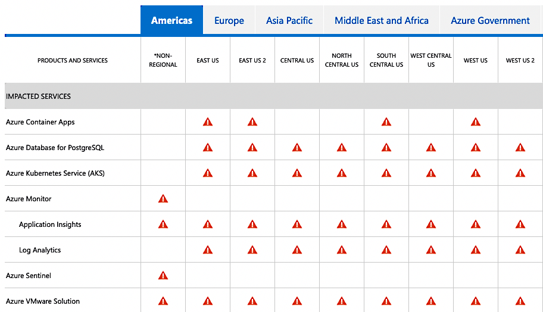

During my work as a Sustaining Engineer at Canonical, occasionally I get tasked
with analysing and fixing high profile regressions that turn into world ending
emergencies. I think I have worked on four or five of these cases now, and
behind each and every one there is a story to tell, and lessons to be learned.

Today, we will dive into the intricate and complex series of events that caused
the worldwide Azure AKS Cloud outage, for systems running Ubuntu 18.04 LTS,
which I had the responsibility and leadership to resolve.



So, go brew a cup of coffee or whip up a hot chocolate, and let's recount the
events that happened four months ago, and how we worked to resolve them without
causing another world ending event to occur.

<!--more-->

# The Impact

Late at night on the 30th of August, workloads hosted in Bionic VMs and 
containers running on Azure Kubernetes Service (AKS), Azure Monitor, 
Azure Sentinel, Azure Container Apps, and a few other services started failing, 
after they had consumed a "bad" systemd package 237-3ubuntu10.54, which
unattended-upgrades had dutifully installed since it was freshly published to
the -security pocket to fix CVE-2022-2526.

This affected all users of the above services globally, and as you can imagine, 
Azure is a popular platform to host infrastructure, it directly affected a 
considerable amount of businesses, small and large, in their day-to-day 
activities, which brought about media attention.

Its not often that bugs make the news, but this one was well written about:
* [Azure customers running Canonical Ubuntu 18.04 experiencing DNS errors](https://news.ycombinator.com/item?id=32649273)
* [Systemd takes Ubuntu down on Azure?](https://news.ycombinator.com/item?id=32659631)
* [Ubuntu Linux 18.04 systemd security patch breaks DNS in Microsoft Azure](https://www.theregister.com/2022/08/30/ubuntu_systemd_dns_update/)
* [Microsoft Azure outage continues for some services relying on Ubuntu 'Bionic' release ](https://www.zdnet.com/article/microsoft-azure-outage-continues-for-some-services-relying-on-ubuntu-bionic-release/)
* [Dodgy Microsoft Azure update knocks Ubuntu VMs offline](https://www.techradar.com/news/dodgy-microsoft-azure-update-knocks-ubuntu-vms-offline)
* [Ubuntu update causes server downtime on Microsoft Azure](https://mybroadband.co.za/news/software/458579-ubuntu-update-causes-server-downtime-on-microsoft-azure.html)
* [Ubuntu Linux 18.04 systemd Security Patch Breaks DNS in Microsoft Azure](https://linuxsecurity.com/news/security-vulnerabilities/ubuntu-linux-18-04-systemd-security-patch-breaks-dns-in-microsoft-azure)
* [Microsoft Azure outage knocks Ubuntu VMs offline after buggy update](https://www.bleepingcomputer.com/news/microsoft/microsoft-azure-outage-knocks-ubuntu-vms-offline-after-buggy-update/)
* [Microsoft Blames Ubuntu Update DNS Problems for Azure Services Outage](https://redmondmag.com/articles/2022/08/30/microsoft-blames-ubuntu-update-dns-problems-for-azure-services-outage.aspx)
* [Microsoft is Investigating Azure Outage Affecting Ubuntu VMs](https://petri.com/microsoft-azure-outage-ubuntu-vms/)
* [Bad Ubuntu update crashes global Azure Kubernetes services](https://thestack.technology/azure-kubernetes-outage-ubuntu-dns/)
* [Microsoft Azure's Canonical Ubuntu service experiencing DNS errors](https://www.datacenterdynamics.com/en/news/microsoft-azures-canonical-ubuntu-service-experiencing-dns-errors/)
* [Outage for Ubuntu users on Azure](https://www.itnews.com.au/news/outage-for-ubuntu-users-on-azure-584656)
* [Ubuntu Linux and Azure DNS Problem Gives Azure Fits](https://thenewstack.io/ubuntu-linux-and-azure-dns-problem-gives-azure-fits/)
* [Ubuntu update on Azure VMs causing DNS problems](https://cloud7.news/cloud/ubuntu-update-on-azure-vms-causing-dns-problems/)

At this point, Microsoft Support on Tweeted about it:

<blockquote class="twitter-tweet" data-conversation="none" data-lang="en"><p lang="en" dir="ltr">We are aware of an ongoing incident with VMs that recently upgraded to system version 237-3ubuntu 10.54 experiencing DNS error. Please keep updated by following the Azure status page here: https://msft.it/6014jcVEG ^CR</p>&mdash; Azure Support (@azuresupport) <a href="https://twitter.com/AzureSupport/status/1564577499606286336">August 30, 2022</a></blockquote>


In terms of impact, this is about as big as you can get. Numerous businesses
were disrupted, and many experienced outages. People were woken up in the middle
of the night, paged by downtime watchdogs, and had to try figure out what on
earth went wrong.

I got into work in the morning, and it was like any normal day. Well, until I had
read the news, saw the event ongoing, and a new case was freshly escalated
to Sustaining Engineering.

# Its Not DNS; There's no way its DNS; It was DNS

At this point, there was much speculation that it was the changes made to
237-3ubuntu10.54 that caused the regression, and it simply did not get caught
by our internal regression test testsuites.

Nishit Majithia prepared the upload, which was actually pretty straightforward:

```
systemd (237-3ubuntu10.54) bionic-security; urgency=medium

  * SECURITY UPDATE: Use-after-free vulnerability in systemd.                   
    - debian/patches/CVE-2022-2526.patch: pin stream while calling callbacks     
      for it in src/resolve/resolved-dns-stream.c                               
    - CVE-2022-2526 

 -- Nishit Majithia <nishit.majithia@canonical.com>  Mon, 29 Aug 2022 10:28:49 +0530
```

The diff is very basic, but it does directly change systemd-resolved and dns
processing:

```
diff -Nru systemd-237/debian/patches/CVE-2022-2526.patch systemd-237/debian/patches/CVE-2022-2526.patch
--- systemd-237/debian/patches/CVE-2022-2526.patch	1970-01-01 00:00:00.000000000 +0000
+++ systemd-237/debian/patches/CVE-2022-2526.patch	2022-08-25 13:45:15.000000000 +0000
@@ -0,0 +1,33 @@
+From d973d94dec349fb676fdd844f6fe2ada3538f27c Mon Sep 17 00:00:00 2001
+From: Lennart Poettering <lennart@poettering.net>
+Date: Tue, 4 Dec 2018 22:13:39 +0100
+Subject: [PATCH] resolved: pin stream while calling callbacks for it
+
+These callbacks might unref the stream, but we still have to access it,
+let's hence ref it explicitly.
+
+Maybe fixes: #10725
+---
+ src/resolve/resolved-dns-stream.c | 4 +++-
+ 1 file changed, 3 insertions(+), 1 deletion(-)
+
+--- systemd-237.orig/src/resolve/resolved-dns-stream.c
++++ systemd-237/src/resolve/resolved-dns-stream.c
+@@ -64,6 +64,8 @@ static int dns_stream_update_io(DnsStrea
+ }
+ 
+ static int dns_stream_complete(DnsStream *s, int error) {
++	_cleanup_(dns_stream_unrefp) _unused_ DnsStream *ref = dns_stream_ref(s); /* Protect stream while we process it */
++
+         assert(s);
+         assert(error >= 0);
+ 
+@@ -214,7 +216,7 @@ static int on_stream_timeout(sd_event_so
+ }
+ 
+ static int on_stream_io(sd_event_source *es, int fd, uint32_t revents, void *userdata) {
+-        DnsStream *s = userdata;
++        _cleanup_(dns_stream_unrefp) DnsStream *s = dns_stream_ref(userdata); /* Protect stream while we process it */
+         bool progressed = false;
+         int r;
+ 
```

However, the changes to the systemd package in 237-3ubuntu10.54 was completely
benign. We simply take a reference count to the dns stream to make sure it is
not freed when there are still references pointing to it.

Benign or not, if a package causes a regression, it gets pulled from the Ubuntu
archive until root cause is found, and a update issued to correct it. systemd
237-3ubuntu10.54 was removed from -security and -updates, and placed into
-proposed.

The interesting thing we all noted, is that it did not affect server installs on
bare metal, KVM, LXC or any other public cloud, like GCP or AWS.

A Launchpad bug was filed, and this is where most of our information about the
regression was kept. [LP1988119 Update to systemd 237-3ubuntu10.54 broke dns](https://bugs.launchpad.net/ubuntu/+source/systemd/+bug/1988119)

At this point, Kyler Horner from the Support Team was working with Azure
Engineers over a Google Meet, and had a breakthrough.

They noticed that the `hv_netvsc` kernel module is dropped from 
`udevadm info /sys/class/net/eth0` after unattended-upgrades upgrades a fresh
Ubuntu Cloud Image for Azure. If you install the problematic systemd package
after unattended-upgrades had finished running, everything breaks.

The package in question was soon narrowed down to `open-vm-tools`. If you
installed open-vm-tools before systemd, DNS stops working, and the VM loses
networking.

Looking more closely at open-vm-tools 11.0.5-4ubuntu0.18.04.1 in bionic,
we find the following postinstall script:

`debian/open-vm-tools.postinst`:
```
#!/bin/sh

set -e

case "${1}" in
    configure)
        if which udevadm 1>/dev/null; then
            udevadm trigger || true
        fi
        ;;

    abort-upgrade|abort-remove|abort-deconfigure)

        ;;

    *)
        echo "postinst called with unknown argument \`${1}'" >&2
        exit 1
        ;;
esac

#DEBHELPER#

exit 0
```

Okay, so when open-vm-tools is run, it calls a wholesale `udevadm trigger || true`.
Then, when systemd is installed, it restarts the systemd-networkd service, and
then the issue is reproduced.

So, we have a minimal reproducer.

Start a VM on Azure:
```
1. $ ping google.com
PING google.com (172.253.62.102) 56(84) bytes of data.
64 bytes from bc-in-f102.1e100.net (172.253.62.102): icmp_seq=1 ttl=56 
2. sudo udevadm trigger
3. sudo systemctl restart systemd-networkd
4. ping google.com
ping: google.com: Temporary failure in name resolution
```

Now, the udev (userspace /dev) subsystem is responsible managing device nodes
in /dev, and does so by constantly scanning for devices and hotplug events,
and when one happens, it applies a series of udev rules, and makes sure the
correct kernel module is loaded for whatever piece of hardware is attached, or
a script run, etc.

In this case, let's consider the output of `udevadm info /sys/class/net/eth0`,
the ethernet device powered by `hv_netvsc`.

```
$ sudo apt-cache policy systemd | grep Installed
  Installed: 237-3ubuntu10.53
$ udevadm info /sys/class/net/eth0
P: /devices/LNXSYSTM:00/LNXSYBUS:00/ACPI0004:00/VMBUS:00/000d3a1b-6d42-000d-3a1b-6d42000d3a1b/net/eth0
E: DEVPATH=/devices/LNXSYSTM:00/LNXSYBUS:00/ACPI0004:00/VMBUS:00/000d3a1b-6d42-000d-3a1b-6d42000d3a1b/net/eth0
E: ID_NET_DRIVER=hv_netvsc
E: ID_NET_LINK_FILE=/run/systemd/network/10-netplan-eth0.link
E: ID_NET_NAME=eth0
E: ID_NET_NAME_MAC=enx000d3a1b6d42
E: ID_OUI_FROM_DATABASE=Microsoft Corp.
E: ID_PATH=acpi-VMBUS:00
E: ID_PATH_TAG=acpi-VMBUS_00
E: IFINDEX=2
E: INTERFACE=eth0
E: NM_UNMANAGED=1
E: SUBSYSTEM=net
E: SYSTEMD_ALIAS=/sys/subsystem/net/devices/eth0
E: TAGS=:systemd:
E: USEC_INITIALIZED=1977684
```

If we then issue udevadm trigger:

```
$ sudo udevadm trigger
$ udevadm info /sys/class/net/eth0
P: /devices/LNXSYSTM:00/LNXSYBUS:00/ACPI0004:00/VMBUS:00/000d3a1b-6d42-000d-3a1b-6d42000d3a1b/net/eth0
E: DEVPATH=/devices/LNXSYSTM:00/LNXSYBUS:00/ACPI0004:00/VMBUS:00/000d3a1b-6d42-000d-3a1b-6d42000d3a1b/net/eth0
E: ID_NET_NAME_MAC=enx000d3a1b6d42
E: ID_OUI_FROM_DATABASE=Microsoft Corp.
E: ID_PATH=acpi-VMBUS:00
E: ID_PATH_TAG=acpi-VMBUS_00
E: IFINDEX=2
E: INTERFACE=eth0
E: SUBSYSTEM=net
E: SYSTEMD_ALIAS=/sys/subsystem/net/devices/eth0
E: TAGS=:systemd:
E: USEC_INITIALIZED=1977684
```

We lost a few attributes, namely `ID_NET_DRIVER`, `ID_NET_LINK_FILE`, `ID_NET_NAME`.

These attributes turn out to be really, really important.

The `eth0` device is managed by Netplan on Azure. Looking at the YAML extracted
from an Azure instance:

```
network:
    ethernets:
        eth0:
            dhcp4: true
            match:
                driver: hv_netvsc
                macaddress: 00:0d:3a:1a:b4:7d
            set-name: eth0
    version: 2
```

We see that we are directly matching on `driver: hv_netvsc`. But how does
Netplan match for `hv_netvsc`? It checks `ID_NET_DRIVER`!

When Netplan cannot match `ID_NET_DRIVER`, systemd-networkd cannot manage the
interface. So when systemd-networkd is restarted, eth0 becomes unmanaged, and
DNS goes down.

```
$ ping google.com
ping: google.com: Temporary failure in name resolution
```

## Workarounds

At this point, the community were coming up with all sorts of workarounds to get
DNS restored. I'll document a few, since they are interesting.

You can manually run dhclient:

```
$ dhclient -x
$ dhclient -i eth0
```

You can reboot the node, (what I recommended early on).

Another solution was to send an `ADD` uevent to the device missing `ID_NET_DRIVER`:

```
$ sudo udevadm trigger -c add -y eth0
```

and the various ways of populating `/etc/resolve.conf` from within Kubernetes:

```
$ VMSS=XXX-vmss
$ nodeResourceGroup=XXX-worker
$ az vmss list-instances -g $nodeResourceGroup -n $VMSS --query "[].id" --output tsv | az vmss run-command invoke --scripts "systemd-resolve --set-dns=your_dns --set-dns=your_dns --set-domain=reddog.microsoft.com --interface=eth0" --command-id RunShellScript --ids @-
```

```
kubectl get no -o json | jq -r '.items[].spec.providerID' | cut -c 9- | az vmss run-command invoke --ids @- \
  --command-id RunShellScript \
  --scripts 'grep nameserver /etc/resolv.conf || { dhclient -x; dhclient -i eth0; sleep 10; pkill dhclient; grep nameserver /etc/resolv.conf; }'
```

and so on.

Okay, so now we understand the events that lead to the widespread outage. 
An `open-vm-tools` package update was released a few weeks prior, and 
unattended-upgrades had installed it like any other package update. 
This ran a postinstall script that executed `udevadm trigger` wholesale, 
which caused the `ID_NET_DRIVER` attribute to be lost from `eth0`, priming the
systems for failure. When the systemd security update came through, it restarted
systemd-networkd, and since Netplan could not match `hv_netvsc` against
`ID_NET_DRIVER`, `eth0` went unmanaged, and the VM lost DNS, causing failure.

What makes this case interesting, is that this is a complex interaction between
two packages, the type of bug that is extremely hard to find during normal
regression testing.

# The Fix

We have a pretty good understanding of the problem, and even have a minimal
reproducer which makes testing easy. Time to dive in and find the actual root
cause, and determine what needs to be fixed.

## systemd

Chris Coulson, from the Security Team had found the commit that would likely fix
the issue before I had even read the case, and that is:

```
commit e0e789c1e97e2cdf1cafe0c6b7d7e43fa054f151
Author: Yu Watanabe <watanabe.yu+github@gmail.com>
Date: Mon, 14 Sep 2020 15:21:04 +0900
Subject: udev: re-assign ID_NET_DRIVER=, ID_NET_LINK_FILE=, ID_NET_NAME= properties on non-'add' uevent
Link: https://github.com/systemd/systemd/commit/e0e789c1e97e2cdf1cafe0c6b7d7e43fa054f151
```

When I got in in the morning, I read the case, created a few Azure VMs, made
sure I could reproduce the issue, and set about backporting the commit to test
if it does indeed fix the issue.

This means the bug exists in systemd itself, in the udev subsystem. Looking
closer at the patch:

```
From e0e789c1e97e2cdf1cafe0c6b7d7e43fa054f151 Mon Sep 17 00:00:00 2001
From: Yu Watanabe <watanabe.yu+github@gmail.com>
Date: Mon, 14 Sep 2020 15:21:04 +0900
Subject: [PATCH] udev: re-assign ID_NET_DRIVER=, ID_NET_LINK_FILE=,
 ID_NET_NAME= properties on non-'add' uevent

Previous commit makes drop ID_NET_DRIVER=, ID_NET_LINK_FILE=, and
ID_NET_NAME= properties for network interfaces on 'move' uevent.
ID_NET_DRIVER= and ID_NET_LINK_FILE= properties are used by networkctl.
ID_NET_NAME= may be used by end-user rules or programs. So, let's
re-assign them on 'move' uevent. (Note that strictly speaking, this
makes them re-assigned on all but 'remove' uevent.)
---
 rules.d/80-net-setup-link.rules |  2 +-
 src/udev/net/link-config.c      | 30 +++++++++++++++++++++++++++---
 2 files changed, 28 insertions(+), 4 deletions(-)

diff --git a/rules.d/80-net-setup-link.rules b/rules.d/80-net-setup-link.rules
index 6e411a91f0ec..bafc3fbc846b 100644
--- a/rules.d/80-net-setup-link.rules
+++ b/rules.d/80-net-setup-link.rules
@@ -4,7 +4,7 @@ SUBSYSTEM!="net", GOTO="net_setup_link_end"
 
 IMPORT{builtin}="path_id"
 
-ACTION!="add", GOTO="net_setup_link_end"
+ACTION=="remove", GOTO="net_setup_link_end"
 
 IMPORT{builtin}="net_setup_link"
 
diff --git a/src/udev/net/link-config.c b/src/udev/net/link-config.c
index 77edbb674dc7..5c871b671796 100644
--- a/src/udev/net/link-config.c
+++ b/src/udev/net/link-config.c
@@ -11,6 +11,7 @@
 #include "conf-files.h"
 #include "conf-parser.h"
 #include "def.h"
+#include "device-private.h"
 #include "device-util.h"
 #include "ethtool-util.h"
 #include "fd-util.h"
@@ -605,6 +606,7 @@ static int link_config_apply_alternative_names(sd_netlink **rtnl, const link_con
 
 int link_config_apply(link_config_ctx *ctx, const link_config *config, sd_device *device, const char **ret_name) {
         const char *new_name;
+        DeviceAction a;
         int r;
 
         assert(ctx);
@@ -612,6 +614,20 @@ int link_config_apply(link_config_ctx *ctx, const link_config *config, sd_device
         assert(device);
         assert(ret_name);
 
+        r = device_get_action(device, &a);
+        if (r < 0)
+                return log_device_error_errno(device, r, "Failed to get ACTION= property: %m");
+
+        if (!IN_SET(a, DEVICE_ACTION_ADD, DEVICE_ACTION_BIND, DEVICE_ACTION_MOVE)) {
+                log_device_debug(device, "Skipping to apply .link settings on '%s' uevent.", device_action_to_string(a));
+
+                r = sd_device_get_sysname(device, ret_name);
+                if (r < 0)
+                        return log_device_error_errno(device, r, "Failed to get sysname: %m");
+
+                return 0;
+        }
+
         r = link_config_apply_ethtool_settings(&ctx->ethtool_fd, config, device);
         if (r < 0)
                 return r;
@@ -620,9 +636,17 @@ int link_config_apply(link_config_ctx *ctx, const link_config *config, sd_device
         if (r < 0)
                 return r;
 
-        r = link_config_generate_new_name(ctx, config, device, &new_name);
-        if (r < 0)
-                return r;
+        if (a == DEVICE_ACTION_MOVE) {
+                log_device_debug(device, "Skipping to apply Name= and NamePolicy= on '%s' uevent.", device_action_to_string(a));
+
+                r = sd_device_get_sysname(device, &new_name);
+                if (r < 0)
+                        return log_device_error_errno(device, r, "Failed to get sysname: %m");
+        } else {
+                r = link_config_generate_new_name(ctx, config, device, &new_name);
+                if (r < 0)
+                        return r;
+        }
 
         r = link_config_apply_alternative_names(&ctx->rtnl, config, device, new_name);
         if (r < 0)

```

At face value, the patch simply checks to see what kind of uevent had been issued.
If its anything different than `DEVICE_ACTION_ADD`, `DEVICE_ACTION_BIND`, `DEVICE_ACTION_MOVE`,
such as `DEVICE_ACTION_CHANGE` or `DEVICE_ACTION_REMOVE` then return from 
`link_config_apply()` early. 

If we have a `DEVICE_ACTION_MOVE` uevent, then we keep the existing `Name=`
and `NamePolicy=` attributes, and otherwise, generate new ones.

The important part is the `DEVICE_ACTION_MOVE` hunk, which is what really solves
the issue.

It was at this point that I made a discovery, that we had experienced this exact
same issue two years previous in Focal and Groovy, in [LP1902960 Upgrade from 245.4-4ubuntu3.3 to 245.4-4ubuntu3.2 appears to break DNS resolution in some cases](https://bugs.launchpad.net/ubuntu/+source/systemd/+bug/1902960).

The backport for Focal and Groovy was performed by my colleague at the time,
Dan Streetman. Back then, there was no evidence that Bionic was affected by
this issue, and the problem had not been reproduced there, so for risk of
regression, it was omitted.

```
> while this commit is not included in bionic, due to the difficult nature of 
> reproducing (and verifying) this, and the fact it has only been seen once on 
> a focal image, I don't think it's appropriate to SRU to bionic at this point;
> possibly it may be appropriate if this is ever reproduced with a bionic image.
```

It is easy to get caught up in the moment and think that all of this trouble
could have been avoided if we had just backported the fix to Bionic when the
issue was first discovered, but the world, life, and software engineering
sometimes isn't as simple as that. Any change at all could possibly introduce
a regression to any package in Ubuntu, even a simple no-change rebuild of a
package could introduce a dire regression (it might be linked against a newer
version of a library that you would never think of, which might contain a bug).
Any and all changes to packages in the Ubuntu archive require a great deal of
thought, and sometimes you err on the side of caution and not introduce a change.

At the time, the issue did not reproduce, it wasn't seen anywhere else, while it
directly affected Focal, and while SRU policy stipulates that you need to fix
all stable releases that are affected, you could have easily made the argument
that since the problem was not observed on Bionic, and systemd is a critical
core package, the risk of regression would be very high for something not
testable (at that time).

So, in these situations, it's best to accept the facts of what happened, and
instead of getting frustrated, be happy there is additional information
available on the Launchpad bug, and even more in the debdiff.

Now, looking at Bionic's systemd implementation, we actually have a bit of
an issue:

```
int link_config_apply(link_config_ctx *ctx, link_config *config,
                      struct udev_device *device, const char **name) {
        bool respect_predictable = false;
        struct ether_addr generated_mac;
        struct ether_addr *mac = NULL;
        const char *new_name = NULL;
        const char *old_name;
        unsigned speed;
        int r, ifindex;

        assert(ctx);
        assert(config);
        assert(device);
        assert(name);

        old_name = udev_device_get_sysname(device);
        if (!old_name)
                return -EINVAL;

        r = ethtool_set_glinksettings(&ctx->ethtool_fd, old_name, config);
        if (r < 0) {

                if (config->port != _NET_DEV_PORT_INVALID)
                        log_warning_errno(r,  "Could not set port (%s) of %s: %m", port_to_string(config->port), old_name);

                speed = DIV_ROUND_UP(config->speed, 1000000);
                if (r == -EOPNOTSUPP)
                        r = ethtool_set_speed(&ctx->ethtool_fd, old_name, speed, config->duplex);

                if (r < 0)
                        log_warning_errno(r, "Could not set speed or duplex of %s to %u Mbps (%s): %m",
                                          old_name, speed, duplex_to_string(config->duplex));
        }

        r = ethtool_set_wol(&ctx->ethtool_fd, old_name, config->wol);
        if (r < 0)
                log_warning_errno(r, "Could not set WakeOnLan of %s to %s: %m",
                                  old_name, wol_to_string(config->wol));

        r = ethtool_set_features(&ctx->ethtool_fd, old_name, config->features);
        if (r < 0)
                log_warning_errno(r, "Could not set offload features of %s: %m", old_name);

        ifindex = udev_device_get_ifindex(device);
        if (ifindex <= 0) {
                log_warning("Could not find ifindex");
                return -ENODEV;
        }

        if (ctx->enable_name_policy && config->name_policy) {
                NamePolicy *policy;

                for (policy = config->name_policy;
                     !new_name && *policy != _NAMEPOLICY_INVALID; policy++) {
                        switch (*policy) {
                                case NAMEPOLICY_KERNEL:
                                        respect_predictable = true;
                                        break;
                                case NAMEPOLICY_DATABASE:
                                        new_name = udev_device_get_property_value(device, "ID_NET_NAME_FROM_DATABASE");
                                        break;
                                case NAMEPOLICY_ONBOARD:
                                        new_name = udev_device_get_property_value(device, "ID_NET_NAME_ONBOARD");
                                        break;
                                case NAMEPOLICY_SLOT:
                                        new_name = udev_device_get_property_value(device, "ID_NET_NAME_SLOT");
                                        break;
                                case NAMEPOLICY_PATH:
                                        new_name = udev_device_get_property_value(device, "ID_NET_NAME_PATH");
                                        break;
                                case NAMEPOLICY_MAC:
                                        new_name = udev_device_get_property_value(device, "ID_NET_NAME_MAC");
                                        break;
                                default:
                                        break;
                        }
                }
        }

        if (should_rename(device, respect_predictable)) {
                /* if not set by policy, fall back manually set name */
                if (!new_name)
                        new_name = config->name;
        } else
                new_name = NULL;

        switch (config->mac_policy) {
                case MACPOLICY_PERSISTENT:
                        if (mac_is_random(device)) {
                                r = get_mac(device, false, &generated_mac);
                                if (r == -ENOENT) {
                                        log_warning_errno(r, "Could not generate persistent MAC address for %s: %m", old_name);
                                        break;
                                } else if (r < 0)
                                        return r;
                                mac = &generated_mac;
                        }
                        break;
                case MACPOLICY_RANDOM:
                        if (!mac_is_random(device)) {
                                r = get_mac(device, true, &generated_mac);
                                if (r == -ENOENT) {
                                        log_warning_errno(r, "Could not generate random MAC address for %s: %m", old_name);
                                        break;
                                } else if (r < 0)
                                        return r;
                                mac = &generated_mac;
                        }
                        break;
                case MACPOLICY_NONE:
                default:
                        mac = config->mac;
        }

        r = rtnl_set_link_properties(&ctx->rtnl, ifindex, config->alias, mac, config->mtu);
        if (r < 0)
                return log_warning_errno(r, "Could not set Alias, MACAddress or MTU on %s: %m", old_name);

        *name = new_name;

        return 0;
}
```

Looking at the first hunk:

```
@@ -612,6 +614,20 @@ int link_config_apply(link_config_ctx *ctx, const link_config *config, sd_device
         assert(device);
         assert(ret_name);
 
+        r = device_get_action(device, &a);
+        if (r < 0)
+                return log_device_error_errno(device, r, "Failed to get ACTION= property: %m");
+
+        if (!IN_SET(a, DEVICE_ACTION_ADD, DEVICE_ACTION_BIND, DEVICE_ACTION_MOVE)) {
+                log_device_debug(device, "Skipping to apply .link settings on '%s' uevent.", device_action_to_string(a));
+
+                r = sd_device_get_sysname(device, ret_name);
+                if (r < 0)
+                        return log_device_error_errno(device, r, "Failed to get sysname: %m");
+
+                return 0;
+        }
+
         r = link_config_apply_ethtool_settings(&ctx->ethtool_fd, config, device);
         if (r < 0)
                 return r;
```

If we backport this as-is, we run into numerous problems, namely 
`device_get_action()` does not exist, `log_device_error_errno()` and 
`log_device_debug()` do not exist, and neither does `sd_device_get_sysname()`.

This is because these functions were added sometime after the version of systemd
in Bionic was released.

So, we are up a creek, and we have no paddle. The second hunk is much the same,
systemd has changed substantially since the release of Bionic to when this fix
was authored, and there is no direct way to backport the fix in a cherry-pick
like manner.

I tracked down the commits where these got added:

```
commit a11300221482da7ffe7be2d75d508ddd411814f6
From: Lennart Poettering <lennart@poettering.net>
Date: Wed, 10 Feb 2021 22:15:01 +0100
Subject: sd-device: add sd_device_get_action() +
 sd_device_get_seqnum() + sd_device_new_from_stat_rdev()
Link: https://github.com/systemd/systemd/commit/a11300221482da7ffe7be2d75d508ddd411814f6
```

This commit alone is 145 lines added and 139 lines deleted. The commit does
not backport cleanly at all, and worse, is too significant a change to even
be considered for SRU.

The logging ones are worse:

```
commit ab54f12b783eea891d6414fbc14cd6fe7cbe4c80
From: Yu Watanabe <watanabe.yu+github@gmail.com>
Date: Wed, 9 Sep 2020 02:10:27 +0900
Subject: sd-device: make log_device_error() or friends return void
Link: https://github.com/systemd/systemd/commit/ab54f12b783eea891d6414fbc14cd6fe7cbe4c80

commit edee65a6a4f646b6812aa29fb9bf4f71c313981e
From: =?UTF-8?q?Zbigniew=20J=C4=99drzejewski-Szmek?= <zbyszek@in.waw.pl>
Date: Fri, 17 Dec 2021 11:43:26 +0100
Subject: udev/net_id: add debug logging for construction of device
 names
Link: https://github.com/systemd/systemd/commit/edee65a6a4f646b6812aa29fb9bf4f71c313981e
```

So, we cannot backport these commits just to get some functions required for a
fix, no matter how critical the fix is. We are going to have to come up with 
another backport, which is functionally the same, that uses the functions
present in the Bionic implementation of systemd.

This is when I was very pleased to have the fixes from Focal and Groovy to study.

Let's have a look at Dan Streetman's backport to Focal:

```
From e0e789c1e97e2cdf1cafe0c6b7d7e43fa054f151 Mon Sep 17 00:00:00 2001
From: Yu Watanabe <watanabe.yu+github@gmail.com>
Date: Mon, 14 Sep 2020 15:21:04 +0900
Subject: [PATCH] udev: re-assign ID_NET_DRIVER=, ID_NET_LINK_FILE=,
 ID_NET_NAME= properties on non-'add' uevent
Bug: https://github.com/systemd/systemd/issues/17532
Bug-Ubuntu: https://bugs.launchpad.net/ubuntu/+source/systemd/+bug/1902960
Origin: upstream, https://github.com/systemd/systemd/commit/e0e789c1e97e2cdf1cafe0c6b7d7e43fa054f151

Previous commit makes drop ID_NET_DRIVER=, ID_NET_LINK_FILE=, and
ID_NET_NAME= properties for network interfaces on 'move' uevent.
ID_NET_DRIVER= and ID_NET_LINK_FILE= properties are used by networkctl.
ID_NET_NAME= may be used by end-user rules or programs. So, let's
re-assign them on 'move' uevent. (Note that strictly speaking, this
makes them re-assigned on all but 'remove' uevent.)
---
NOTE: backported from upstream, to keep as much backwards compatibility as possible;
specifically 1) don't return failure if device_get_action() fails, and 2) context
adjustments since the upstream commit builds on splitting out the function
action into separate functions, which our code doesn't include.

 rules.d/80-net-setup-link.rules |  2 +-
 src/udev/net/link-config.c      | 30 +++++++++++++++++++++++++++---
 2 files changed, 28 insertions(+), 4 deletions(-)

--- a/rules.d/80-net-setup-link.rules
+++ b/rules.d/80-net-setup-link.rules
@@ -4,7 +4,7 @@ SUBSYSTEM!="net", GOTO="net_setup_link_e
 
 IMPORT{builtin}="path_id"
 
-ACTION!="add", GOTO="net_setup_link_end"
+ACTION=="remove", GOTO="net_setup_link_end"
 
 IMPORT{builtin}="net_setup_link"
 
--- a/src/udev/net/link-config.c
+++ b/src/udev/net/link-config.c
@@ -10,6 +10,7 @@
 #include "conf-files.h"
 #include "conf-parser.h"
 #include "def.h"
+#include "device-private.h"
 #include "device-util.h"
 #include "ethtool-util.h"
 #include "fd-util.h"
@@ -351,6 +352,7 @@ int link_config_apply(link_config_ctx *c
         struct ether_addr *mac = NULL;
         const char *new_name = NULL;
         const char *old_name;
+        DeviceAction a = _DEVICE_ACTION_INVALID;
         unsigned speed, name_type = NET_NAME_UNKNOWN;
         NamePolicy policy;
         int r, ifindex;
@@ -364,6 +366,16 @@ int link_config_apply(link_config_ctx *c
         if (r < 0)
                 return r;
 
+        r = device_get_action(device, &a);
+        if (r < 0)
+                log_device_warning_errno(device, r, "Failed to get ACTION= property: %m");
+        else if (!IN_SET(a, DEVICE_ACTION_ADD, DEVICE_ACTION_BIND, DEVICE_ACTION_MOVE)) {
+                log_device_debug(device, "Skipping to apply .link settings on '%s' uevent.", device_action_to_string(a));
+
+                *name = old_name;
+                return 0;
+        }
+
         r = ethtool_set_glinksettings(&ctx->ethtool_fd, old_name,
                                       config->autonegotiation, config->advertise,
                                       config->speed, config->duplex, config->port);
@@ -421,6 +433,12 @@ int link_config_apply(link_config_ctx *c
                 goto no_rename;
         }
 
+        if (a == DEVICE_ACTION_MOVE) {
+                log_device_debug(device, "Skipping to apply Name= and NamePolicy= on '%s' uevent.", device_action_to_string(a));
+                new_name = old_name;
+                goto no_rename;
+        }
+
         if (ctx->enable_name_policy && config->name_policy)
                 for (NamePolicy *p = config->name_policy; *p != _NAMEPOLICY_INVALID; p++) {
                         policy = *p;
```

Okay, this is much more reasonable. This time around, we still use
`device_get_action()`, and `log_device_debug()`, we now set `*name = old_name;`
or `new_name = old_name;` and `goto no_rename;` instead of calling 
`r = sd_device_get_sysname(device, ret_name);`. 

We have `new_name = old_name;`, we can use this knowledge to help us build the
backport to Focal.

Even better, Dan Streetman left us a note:

```
NOTE: backported from upstream, to keep as much backwards compatibility as possible;
specifically 1) don't return failure if device_get_action() fails, and 2) context
adjustments since the upstream commit builds on splitting out the function
action into separate functions, which our code doesn't include.
```

Both of these hints would turn out to be crucial.

The first thing we need to figure out, is how to get the device action name,
and in the form of `DeviceAction` enum.

```
typedef enum DeviceAction {
        DEVICE_ACTION_ADD,
        DEVICE_ACTION_REMOVE,
        DEVICE_ACTION_CHANGE,
        DEVICE_ACTION_MOVE,
        DEVICE_ACTION_ONLINE,
        DEVICE_ACTION_OFFLINE,
        DEVICE_ACTION_BIND,
        DEVICE_ACTION_UNBIND,
        _DEVICE_ACTION_MAX,
        _DEVICE_ACTION_INVALID = -1,
} DeviceAction;
```

We have the enum, which is something, so we can go ahead and add the hunks:

```
@@ -25,6 +25,8 @@
 #include "alloc-util.h"
 #include "conf-files.h"
 #include "conf-parser.h"
+#include "device-private.h"
+#include "device-internal.h"
 #include "ethtool-util.h"
 #include "fd-util.h"
 #include "libudev-private.h"
@@ -371,6 +373,7 @@ int link_config_apply(link_config_ctx *ctx, link_config *config,
         struct ether_addr *mac = NULL;
         const char *new_name = NULL;
         const char *old_name;
+        DeviceAction a = _DEVICE_ACTION_INVALID;
         unsigned speed;
         int r, ifindex;
```

Next, let's look at `r = device_get_action(device, &a);`

We are taking `struct udev_device` as `device`, and getting the `DeviceAction`
from it, and sticking it in `a`.

I came across `udev_device_get_action()` which returns a string:

```
src/libudev/libudev.h:107:const char *udev_device_get_action(struct udev_device *udev_device);
```

This gets us halfway there. Some further searching around `DeviceAction` parent
header files, `device-internal.h` we find: 

```
DeviceAction device_action_from_string(const char *s) _pure_;
```

which is exactly what we want. So thus:

```
r = device_get_action(device, &a);
```

becomes

```
a = device_action_from_string(udev_device_get_action(device));
```

Quite a tidy backport if I don't say so myself. Now we can reuse the set and
the if statement:

```
else if (!IN_SET(a, DEVICE_ACTION_ADD, DEVICE_ACTION_BIND, DEVICE_ACTION_MOVE)) {
```

and also:

```
if (a == DEVICE_ACTION_MOVE) {
```

keeping the spirit and intention if the upstream commit.

Now, let's look at the first major hunk:

```
@@ -612,6 +614,20 @@ int link_config_apply(link_config_ctx *ctx, const link_config *config, sd_device
         assert(device);
         assert(ret_name);
 
+        r = device_get_action(device, &a);
+        if (r < 0)
+                return log_device_error_errno(device, r, "Failed to get ACTION= property: %m");
+
+        if (!IN_SET(a, DEVICE_ACTION_ADD, DEVICE_ACTION_BIND, DEVICE_ACTION_MOVE)) {
+                log_device_debug(device, "Skipping to apply .link settings on '%s' uevent.", device_action_to_string(a));
+
+                r = sd_device_get_sysname(device, ret_name);
+                if (r < 0)
+                        return log_device_error_errno(device, r, "Failed to get sysname: %m");
+
+                return 0;
+        }
+
         r = link_config_apply_ethtool_settings(&ctx->ethtool_fd, config, device);
         if (r < 0)
                 return r;
```

Comparing this with Dan Streetmans first hunk for Focal:

```
@@ -364,6 +366,16 @@ int link_config_apply(link_config_ctx *c
         if (r < 0)
                 return r;
 
+        r = device_get_action(device, &a);
+        if (r < 0)
+                log_device_warning_errno(device, r, "Failed to get ACTION= property: %m");
+        else if (!IN_SET(a, DEVICE_ACTION_ADD, DEVICE_ACTION_BIND, DEVICE_ACTION_MOVE)) {
+                log_device_debug(device, "Skipping to apply .link settings on '%s' uevent.", device_action_to_string(a));
+
+                *name = old_name;
+                return 0;
+        }
+
         r = ethtool_set_glinksettings(&ctx->ethtool_fd, old_name,
                                       config->autonegotiation, config->advertise,
                                       config->speed, config->duplex, config->port);
```

I came up with the following:

```
@@ -383,6 +386,16 @@ int link_config_apply(link_config_ctx *ctx, link_config *config,
         if (!old_name)
                 return -EINVAL;
 
+        a = device_action_from_string(udev_device_get_action(device));
+        if (a < 0)
+                log_warning_errno(errno, "Failed to get ACTION= property: %m");
+        else if (!IN_SET(a, DEVICE_ACTION_ADD, DEVICE_ACTION_BIND, DEVICE_ACTION_MOVE)) {
+                log_debug("Skipping to apply .link settings on %s device for '%s' uevent.", udev_device_get_sysname(device), device_action_to_string(a));
+
+                *name = old_name;
+                return 0;
+        }
+
         r = ethtool_set_glinksettings(&ctx->ethtool_fd, old_name, config);
         if (r < 0) {
 
```

We check `a` instead of `r`, and we change `log_device_debug` to a plain
`log_debug`, and manually supply the device using `udev_device_get_sysname(device)`.
We also re-use Dan Streetman's idea of `*name = old_name` and `return 0`.

For the second hunk, we do something similar:

The original hunk:

```
@@ -620,9 +636,17 @@ int link_config_apply(link_config_ctx *ctx, const link_config *config, sd_device
         if (r < 0)
                 return r;
 
-        r = link_config_generate_new_name(ctx, config, device, &new_name);
-        if (r < 0)
-                return r;
+        if (a == DEVICE_ACTION_MOVE) {
+                log_device_debug(device, "Skipping to apply Name= and NamePolicy= on '%s' uevent.", device_action_to_string(a));
+
+                r = sd_device_get_sysname(device, &new_name);
+                if (r < 0)
+                        return log_device_error_errno(device, r, "Failed to get sysname: %m");
+        } else {
+                r = link_config_generate_new_name(ctx, config, device, &new_name);
+                if (r < 0)
+                        return r;
+        }
 
         r = link_config_apply_alternative_names(&ctx->rtnl, config, device, new_name);
         if (r < 0)
```

Dan Streetman's backport for Focal:

```
@@ -421,6 +433,12 @@ int link_config_apply(link_config_ctx *c
                 goto no_rename;
         }
 
+        if (a == DEVICE_ACTION_MOVE) {
+                log_device_debug(device, "Skipping to apply Name= and NamePolicy= on '%s' uevent.", device_action_to_string(a));
+                new_name = old_name;
+                goto no_rename;
+        }
+
         if (ctx->enable_name_policy && config->name_policy)
                 for (NamePolicy *p = config->name_policy; *p != _NAMEPOLICY_INVALID; p++) {
                         policy = *p;
```

and what I came up with:

```
@@ -413,6 +426,13 @@ int link_config_apply(link_config_ctx *ctx, link_config *config,
                 return -ENODEV;
         }
 
+        if (a == DEVICE_ACTION_MOVE) {
+                log_debug("Skipping to apply Name= and NamePolicy= on %s device for '%s' uevent.", udev_device_get_sysname(device), device_action_to_string(a));
+
+                *name = old_name;
+                return 0;
+        }
+
         if (ctx->enable_name_policy && config->name_policy) {
                 NamePolicy *policy;
 
```

We keep the same sort of structure as Dan Streetman, but since `no_rename` label
does not exist, we simply `return 0` early.

and thus, we have the final patch:

```
From e0e789c1e97e2cdf1cafe0c6b7d7e43fa054f151 Mon Sep 17 00:00:00 2001
From: Yu Watanabe <watanabe.yu+github@gmail.com>
Date: Mon, 14 Sep 2020 15:21:04 +0900
Subject: [PATCH] udev: re-assign ID_NET_DRIVER=, ID_NET_LINK_FILE=,
 ID_NET_NAME= properties on non-'add' uevent
Bug: https://github.com/systemd/systemd/issues/17532
Bug-Ubuntu: https://bugs.launchpad.net/ubuntu/+source/systemd/+bug/1988119
Origin: upstream, https://github.com/systemd/systemd/commit/e0e789c1e97e2cdf1cafe0c6b7d7e43fa054f151

Previous commit makes drop ID_NET_DRIVER=, ID_NET_LINK_FILE=, and
ID_NET_NAME= properties for network interfaces on 'move' uevent.
ID_NET_DRIVER= and ID_NET_LINK_FILE= properties are used by networkctl.
ID_NET_NAME= may be used by end-user rules or programs. So, let's
re-assign them on 'move' uevent. (Note that strictly speaking, this
makes them re-assigned on all but 'remove' uevent.)
---
NOTE: backported from upstream, to keep as much backwards compatibility as possible;
specifically 1) don't return failure if device_get_action() fails, and 2) context
adjustments since the upstream commit builds on splitting out the function
action into separate functions, which our code doesn't include.
 rules/80-net-setup-link.rules |  2 +-
 src/udev/net/link-config.c    | 20 ++++++++++++++++++++
 2 files changed, 21 insertions(+), 1 deletion(-)

diff --git a/rules/80-net-setup-link.rules b/rules/80-net-setup-link.rules
index 6e411a9..bafc3fb 100644
--- a/rules/80-net-setup-link.rules
+++ b/rules/80-net-setup-link.rules
@@ -4,7 +4,7 @@ SUBSYSTEM!="net", GOTO="net_setup_link_end"
 
 IMPORT{builtin}="path_id"
 
-ACTION!="add", GOTO="net_setup_link_end"
+ACTION=="remove", GOTO="net_setup_link_end"
 
 IMPORT{builtin}="net_setup_link"
 
diff --git a/src/udev/net/link-config.c b/src/udev/net/link-config.c
index a4368f0..4c7e87d 100644
--- a/src/udev/net/link-config.c
+++ b/src/udev/net/link-config.c
@@ -25,6 +25,8 @@
 #include "alloc-util.h"
 #include "conf-files.h"
 #include "conf-parser.h"
+#include "device-private.h"
+#include "device-internal.h"
 #include "ethtool-util.h"
 #include "fd-util.h"
 #include "libudev-private.h"
@@ -371,6 +373,7 @@ int link_config_apply(link_config_ctx *ctx, link_config *config,
         struct ether_addr *mac = NULL;
         const char *new_name = NULL;
         const char *old_name;
+        DeviceAction a = _DEVICE_ACTION_INVALID;
         unsigned speed;
         int r, ifindex;
 
@@ -383,6 +386,16 @@ int link_config_apply(link_config_ctx *ctx, link_config *config,
         if (!old_name)
                 return -EINVAL;
 
+        a = device_action_from_string(udev_device_get_action(device));
+        if (a < 0)
+                log_warning_errno(errno, "Failed to get ACTION= property: %m");
+        else if (!IN_SET(a, DEVICE_ACTION_ADD, DEVICE_ACTION_BIND, DEVICE_ACTION_MOVE)) {
+                log_debug("Skipping to apply .link settings on %s device for '%s' uevent.", udev_device_get_sysname(device), device_action_to_string(a));
+
+                *name = old_name;
+                return 0;
+        }
+
         r = ethtool_set_glinksettings(&ctx->ethtool_fd, old_name, config);
         if (r < 0) {
 
@@ -413,6 +426,13 @@ int link_config_apply(link_config_ctx *ctx, link_config *config,
                 return -ENODEV;
         }
 
+        if (a == DEVICE_ACTION_MOVE) {
+                log_debug("Skipping to apply Name= and NamePolicy= on %s device for '%s' uevent.", udev_device_get_sysname(device), device_action_to_string(a));
+
+                *name = old_name;
+                return 0;
+        }
+
         if (ctx->enable_name_policy && config->name_policy) {
                 NamePolicy *policy;
 
-- 
2.34.1
```

I quickly got a test package building in a ppa, and eagerly attempted to
reproduce the issue:

```
$ sudo udevadm trigger && sudo systemctl restart systemd-networkd
$ ping google.com
PING google.com (172.253.122.138) 56(84) bytes of data.
64 bytes from bh-in-f138.1e100.net (172.253.122.138): icmp_seq=1 ttl=103 time=1.67 ms
```

I was relieved. The fix worked as intended, and we fixed the bug. 
I then created a proper debdiff, and uploaded it to the Launchpad bug as 
systemd 237-3ubuntu10.55.

[debdiff for systemd 237-3ubuntu10.55](https://launchpadlibrarian.net/621043086/lp1988119_bionic.debdiff)

```
systemd (237-3ubuntu10.55) bionic; urgency=medium

  * d/p/lp1988119-udev-re-assign-ID_NET_DRIVER-ID_NET_LINK_FILE-ID_NET.patch:
    Run net_setup_link on 'change' uevents, important for users of the
    hv_netvsc driver on Azure. (LP: #1988119)

 -- Matthew Ruffell <matthew.ruffell@canonical.com>  Wed, 31 Aug 2022 16:35:20 +1200
```

With a full SRU template on the Launchpad bug description, this was ready to
go.

[SRU template](https://bugs.launchpad.net/ubuntu/+source/systemd/+bug/1988119)

I message Nishit on Mattermost, and we got this built, and placed into the
ubuntu-security-proposed ppa, since this was going through -security, and not
-updates.

By the time the package hit ubuntu-security-proposed, we are about 8 hours into
my day, and since the issue was no longer absolutely critical, I decided to
err on the side of caution and ask Microsoft Azure engineers for a review
and signoff of the packages in -proposed.

Looking back, this decision to wait for stakeholder signoff before release was
one of the most important decisions in this whole case.

## udev Preinstall Script

Microsoft got back the next morning, mentioning that the fix works as intended,
works great, and is robust.

But.

Well, the fix is only robust on systems that have been rebooted, or are 
**non primed**. That is, systems that haven't lost `ID_NET_DRIVER` or have
recovered it already.

If a system had already lost `ID_NET_DRIVER`, for example, by installing
`open-vm-tools` and not yet installing the benign systemd security update,
the failure would still occur.

If we had rushed and released systemd 237-3ubuntu10.55 as it was, it would have
likely taken Bionic VMs running on Azure down for a second time.

So, we needed a plan to fix all the machines that are currently 'primed'.
Microsoft suggested a preinstall script like the following:

```
pushd /sys/class/net
for i in *; do
  echo -n "Checking $i: "
  if ! (udevadm info /sys/class/net/$i | grep ID_NET_DRIVER); then
    echo "executing trigger on link $i to add ID_NET_DRIVER."
    udevadm trigger -c add -y $i
  fi
done
popd
```

What it did was for every network device, grep for `ID_NET_DRIVER`, and if it
is missing, issue a `ADD` uevent to the device.

This would certainly fix the issue, but I was initially very concerned about
running this script on not just every single VM running on Azure, but the whole
cohort, from bare metal to KVM VMs to Virtualbox to AWS to GCP to Oracle cloud.
I was quite anxious at the thought, since I didn't know if issuing a bunch
of `ADD` uevents to every Bionic machine in the wild would cause any additional
problems, or a regression.

Instead, I wanted to add a much safer, more targeted fix, of a udev rule,
like the following:

```
/etc/udev/rules.d/67-azure-network.rules:
SUBSYSTEM=="net", SUBSYSTEMS=="vmbus", DRIVERS=="hv_netvsc", ENV{ID_NET_DRIVER}="hv_netvsc"
```

This would directly target Azure VMs only, and it would directly target `hv_netvsc`
devices. I suggested we stick this in the walinuxagent package, but there were
additional issues such as needing to call 
`udevadm control --reload-rules && udevadm trigger` to make the rule apply,
so we would need to add that in, or make upgrading the udev package add this in.

This causes further problems since we would force reload all rules during an
upgrade and apply them, causing the event that caused the issue in the first
place, and it would override manually changed udev rules with system file rules,
which could create problems for some running systems.

There were also other problems with the udev rule, such as only replacing
`ID_NET_DRIVER` when we had also lost additional attributes, and the udev rule
would then have to persist forever.

After discussing this with Microsoft engineers, we all decided that the
preinstall script was the best way forward.

I wrote up a proof of concept to ensure it only gets called once, on upgrade
from any package below systemd 237-3ubuntu10.56, so we only have one upgrade
where we worry about regression risk for `ADD` uevents. I wrapped it in a
function, and made sure we return `true` at the call to the `ADD` uevent.

```
diff -Nru systemd-237/debian/udev.preinst systemd-237/debian/udev.preinst
--- systemd-237/debian/udev.preinst	2021-12-10 22:15:07.000000000 +1300
+++ systemd-237/debian/udev.preinst	2022-09-06 15:18:05.000000000 +1200
@@ -55,6 +55,17 @@
   fi
 }
 
+check_ID_NET_DRIVER() {
+  # Ensure ID_NET_DRIVER is set on Network interfaces LP: #1988119
+  for i in $(ls /sys/class/net); do
+    echo -n "Checking $i: "
+    if ! (udevadm info /sys/class/net/$i | grep ID_NET_DRIVER); then
+      echo "Executing trigger on link $i to add ID_NET_DRIVER."
+      udevadm trigger -c add -y $i || true
+    fi
+  done
+}
+
 check_version() {
   # $2 is non-empty when installing from the "config-files" state
   [ -n "$2" ] || return 0
@@ -70,6 +81,10 @@
       udevadm control --log-priority=0 || true
     fi
   fi # 204-4
+
+  if dpkg --compare-versions $2 lt 237-3ubuntu10.56; then
+    check_ID_NET_DRIVER  
+  fi # 237-3ubuntu10.56  
 }
 
 case "$1" in
```

This worked great in a test package. It did generate a bit of output though:

```
Preparing to unpack .../udev_237-3ubuntu10.55+sf343528v20220906b3_amd64.deb ...
Checking enP50633s1: Executing trigger on link enP50633s1 to add ID_NET_DRIVER.
Checking eth0: Executing trigger on link eth0 to add ID_NET_DRIVER.
Checking lo: Executing trigger on link lo to add ID_NET_DRIVER.
Unpacking udev (237-3ubuntu10.55+sf343528v20220906b3) over (237-3ubuntu10.53) ...
```

Checking the package upgrade on an already primed system:

```
$ udevadm info /sys/class/net/eth0 | grep ID_NET_DRIVER
E: ID_NET_DRIVER=hv_netvsc
$ sudo udevadm trigger
$ udevadm info /sys/class/net/eth0 | grep ID_NET_DRIVER
$ sudo apt update
$ sudo apt install libnss-systemd libpam-systemd libsystemd0 libudev1 systemd systemd-sysv udev
$ udevadm info /sys/class/net/eth0 | grep ID_NET_DRIVER
E: ID_NET_DRIVER=hv_netvsc
$ ping google.com
PING google.com (172.253.122.138) 56(84) bytes of data.
64 bytes from bh-in-f138.1e100.net (172.253.122.138): icmp_seq=1 ttl=103 time=1.67 ms
```

At this point, I was quite worried about the impact of issuing a `ADD` uevent
on all Bionic systems, so I made my second best decision in this case:

Asking for help.

I wrote an email to the Foundations, Server, Security, and Sustaining 
Engineering teams, explaining the root cause, minimal reproducer, the choice
not to go with a udev rule, and instead the preinstall script.

I asked for any and all advice on issuing `ADD` uevents on a mass scale, to
code review of the preinstall script, and general approach.

I got several replies.

The first, was from Christian Ehrhardt, of the Server team, who over the years,
I have asked for help a few times, and always received well thought out and
expert advice.

Christian pointed out that:

```
+  for i in $(ls /sys/class/net); do
+    echo -n "Checking $i: "
```

will be too noisy. His own laptop had 17 entries, and since every bridge, veth,
and vpn will also be there, larger servers could very well have hundreds of
entries. Christian suggested that we log once that devices are re-probed, and
then log to a file with logger for each device that actually gets modified.

Christian also suggested to use `udevadm settle` to avoid any potential
thunderstorms on larger, busier servers when we call `udevadm trigger -c add`
in rapid succession. 

Christian also suggested that `/sys/class/net/lo` will not have a driver, and
can skipped being re-added.

Next, Alex Murray, from the Security Team wrote back, and suggested we use a
glob instead of ls to get devices, and also omit `lo` like so:

```
   for i in /sys/class/net/[!lo]*; do
```

Finally, my colleage Mauricio Oliveira chimed in, and offered some thought
provoking advice on the benefits and pitfalls of using `ADD` uevents instead
of `CHANGE`. 

I took everyone's advice on board, and pondered the more theoretical problems
that had been raised. The result from everyone's feedback and a bit more 
tweaking is the final debdiff for systemd 237-3ubuntu10.56:

[debdiff for systemd 237-3ubuntu10.56](https://launchpadlibrarian.net/622189118/lp1988119_bionic_part_two_V2.debdiff)

```
diff -Nru systemd-237/debian/changelog systemd-237/debian/changelog
--- systemd-237/debian/changelog	2022-08-31 16:35:20.000000000 +1200
+++ systemd-237/debian/changelog	2022-09-06 15:18:05.000000000 +1200
@@ -1,3 +1,12 @@
+systemd (237-3ubuntu10.56) bionic; urgency=medium
+
+  * debian/udev.preinst:
+    Add check_ID_NET_DRIVER() to ensure that on upgrade or install
+    from an earlier version ID_NET_DRIVER is present on network
+    interfaces. (LP: #1988119)
+
+ -- Matthew Ruffell <matthew.ruffell@canonical.com>  Tue, 06 Sep 2022 15:18:05 +1200
+
 systemd (237-3ubuntu10.55) bionic; urgency=medium
 
   * d/p/lp1988119-udev-re-assign-ID_NET_DRIVER-ID_NET_LINK_FILE-ID_NET.patch:
diff -Nru systemd-237/debian/udev.preinst systemd-237/debian/udev.preinst
--- systemd-237/debian/udev.preinst	2021-12-10 22:15:07.000000000 +1300
+++ systemd-237/debian/udev.preinst	2022-09-06 15:18:05.000000000 +1200
@@ -55,6 +55,17 @@
   fi
 }
 
+check_ID_NET_DRIVER() {
+  # Ensure ID_NET_DRIVER is set on Network interfaces LP: #1988119
+  for i in /sys/class/net/[!lo]*; do
+    if ! (udevadm info $i | grep --silent ID_NET_DRIVER); then
+      logger --id=$$ --priority=user.info "udev.preinst: Executing trigger on link $(basename $i) to add ID_NET_DRIVER."
+      udevadm trigger -c add -y $(basename $i) || true
+    fi
+  done
+  udevadm settle || true
+}
+
 check_version() {
   # $2 is non-empty when installing from the "config-files" state
   [ -n "$2" ] || return 0
@@ -70,6 +81,10 @@
       udevadm control --log-priority=0 || true
     fi
   fi # 204-4
+
+  if dpkg --compare-versions $2 lt 237-3ubuntu10.56; then
+    check_ID_NET_DRIVER  
+  fi # 237-3ubuntu10.56  
 }
 
 case "$1" in
```

This was then built and uploaded to the ubuntu-security-proposed ppa, and I
again tested it on Azure, and it worked like a charm.

From there, I submitted the package to Microsoft for validation from their
engineers, and while I was waiting, began testing systemd 237-3ubuntu10.56 in
every way imaginable.

The next day we got the okay from Microsoft, and we agreed on a release date
for the package, Tuesday 14th September APAC time.

The current day was Saturday, and I was working the APAC weekend shift,
and I began testing the package on bare metal, KVM, Xen, AWS, GCP, Azure, with
as many quirks and oddities that I could imagine.

The package was also subjected to the automated autopkgtests on our internal
infrastructure, and passed all tests.

When Tuesday came around, it was time to follow through and release the update.
Even after spending my entire weekend shift testing, I was still
a little anxious, due to the nature of the changes involved, the overall risk
of regression and the impact a regression could have.

Since the package was being released to -security, unattended-upgrades will 
install the package as soon as it sees it, and if I had made any mistake at all,
at minimum we were looking at causing another complete outage on Azure, and 
worst case, bringing down every Bionic system.

In the end, the update went out smoothly. The preinstall script successfully
fixed up primed machines, and the permanent fix to the systemd codebase was
correct and true, preventing the issue from happening again.

The update was released without any fanfare, with no media coverage, and I
couldn't have been any happier.

# Aftermath

A few noteworthy things happened after the update was released.

## Azure Post Incident Writeup

Microsoft Azure has written up their own Post Incident Review (PIR), which you
can find on the Azure Status website:

[Azure Status History](https://status.azure.com/en-us/status/history/)

Make sure you click the "all" setting for timescale, and search for the terms:

`Post Incident Review (PIR) - Canonical Ubuntu issue impacted VMs and AKS (Tracking ID 2TWN-VT0)`

I can't seem to find a dedicated link. Regardless, they talk about the need for
extra testing and validation, something we will work towards in the near future.

## open-vm-tools

You might be wondering what happened to open-vm-tools, since it started this
whole chain of events.

It turns out, there was a bug already open to limit the scope of `udevadm trigger`
to just the scsi subsystem, since it was only needed there and nowhere else:

[LP1968354 Please do not run udevadm trigger without parameters](https://bugs.launchpad.net/ubuntu/+source/open-vm-tools/+bug/1968354)

This change had been put on hold due to it being low priority, and a one line
fix, and typically we would hold off on these types of updates to reduce churn,
and instead, pair it up with another SRU and piggyback on it instead. 

But due to the high profile of the outage it caused, it was fixed shortly after
the systemd package was released.

```
diff --git a/debian/changelog b/debian/changelog
index 0bfea9a..b8f3ae7 100644
--- a/debian/changelog
+++ b/debian/changelog
@@ -1,3 +1,11 @@
+open-vm-tools (2:11.0.5-4ubuntu0.18.04.3) bionic; urgency=medium
+
+  * d/open-vm-tools.postinst: Fixes issue with "udevadm trigger"
+    affecting all devices that can cause unwanted side-effects.
+    (LP: #1968354)
+
+ -- Bryce Harrington <bryce@canonical.com>  Mon, 19 Sep 2022 22:14:07 +0000
+
 open-vm-tools (2:11.0.5-4ubuntu0.18.04.2) bionic-security; urgency=medium
 
   * SECURITY UPDATE: local privilege escalation
diff --git a/debian/open-vm-tools.postinst b/debian/open-vm-tools.postinst
index f181ab2..aa224fb 100644
--- a/debian/open-vm-tools.postinst
+++ b/debian/open-vm-tools.postinst
@@ -5,7 +5,7 @@ set -e
 case "${1}" in
     configure)
         if which udevadm 1>/dev/null; then
-            udevadm trigger || true
+            udevadm trigger --type=devices --subsystem-match=scsi || true
         fi
         ;;
```

From the debdiff, we see it has been changed to `udevadm trigger --type=devices --subsystem-match=scsi` in 
version `2:11.0.5-4ubuntu0.18.04.3`. Hopefully it will be an extra step to make
sure something like this doesn't happen again on the next open-vm-tools SRU.

## Ubuntu Security Podcast

A few days after the update was released, Alex Murray reached out and suggested
we have a debrief on the Ubuntu Security Podcast, where we talk about the
regression, what happened, how we worked to solve the issue, and give a brief
idea of how we tested and validated the fix.

Nishit spoke as well, and I enjoyed having the opportunity to be on the podcast.
Maybe I should make another appearance sometime.

[Listen to Episode 177 of the Ubuntu Security Podcast](https://ubuntusecuritypodcast.org/episode-177/)

<audio style="width: 100%" controls preload="none">
            <source src="https://people.canonical.com/~amurray/USP/USP_E177.mp3" type="audio/mp3">
</audio>

# Lessons Learned

I think the key takeaways of this outage is the following:

1. Keep calm, and think logically during an outage, even when the world is watching.
2. Never rush to deliver a fix, instead test and aim to get stakeholder signoff before release. They might think of something that you haven't.
3. Ask for help from your immediate colleagues and across teams when you need it, it is not a sign of weakness, but a desire to deliver the best fix possible, the first time, and having advice from world class engineers drives you toward that goal, especially when you are under pressure.

# Conclusion

Well, I hope you enjoyed the deep dive into the interesting, and very strange
case of a complex interaction between two packages causing a cloud wide outage.

It is not often that two packages interacting causes issues, most bugs are
caused within the package itself. But in this case, open-vm-tools primed the
systems just enough to bring a dormant systemd bug to the surface, over 4.5
years after initial release of Bionic.

We covered how we came up with the minimal reproducer, analysed the systemd bug,
and how we backported the fix, how we did not rush to put out a fix, and saved
us from another cloud wide outage as a result, to working together and valuing
everyone's input to develop a successful preinstall script to fix already primed
systems, to delivering the fix worldwide.

Hopefully you enjoyed the read, and as always feel free to [contact me](/about).

Matthew Ruffell
